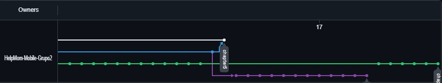
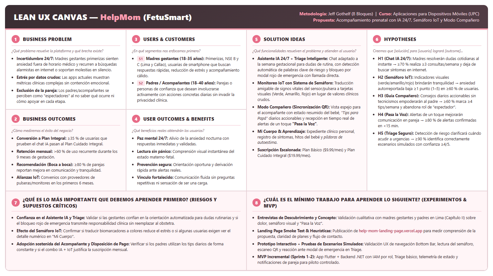

# Universidad Peruana de Ciencias Aplicadas

### Carrera de Ingeniería de Software

 

**Curso:** Aplicaciones para Dispositivos Móviles (1ACC0238)  
**NRC:** 13984

 

## Informe del Trabajo Final

**Docente:** Quevedo Velasco, David Gerardo  
**Equipo:** FetuSmart  
**Proyecto:** HelpMom

 

### Integrantes

| Código | Apellidos, Nombres |
| :---: | :--- |
| u202218590 | Espinoza Cueva, Stephano jose |
| u202223279 | Rivera Ayala, Gabriel Alejandro |
| u202216163| Paredes Davila, Jose Adrian |
| U20211G499 | Moscoso Bejar, Angelo Stephano |
| U20221C726 | Hancco Poma, Keyner Ivan |

  

**Período 202620**  
**Setiembre 2026**

---

## Registro de Versiones del Informe

| Version | Fecha | Autor | Descripcion de Modificacion |
| :---: | :---: | :--- | :--- |
| 0.1 | 10/09/2026 | Stephano Jose Espinoza Cueva | Se agregó la información base del informe, incluyendo la portada institucional, datos del curso, nombre de la startup, producto IoBuild e integrantes del equipo. También se incorporaron las primeras imágenes de presentación y la descripción general del perfil de la startup, dejando preparada la estructura inicial del documento para el desarrollo de los capítulos posteriores. |
| 0.2 | 15/04/2026 | Stephano Jose Espinoza Cueva | Se realizó el primer avance del Capítulo I, desarrollando los antecedentes, la problemática y el contexto del proyecto. Además, se avanzó con el enfoque Lean UX mediante la elaboración del Problem Statement, el registro de supuestos principales, la formulación de Hypothesis Statements y la construcción inicial del Lean UX Canvas para orientar la propuesta de solución. |
| 0.3 | 14/09/2026 | Keyner Hannco Poma | Se revisó y editó el Capítulo I para mejorar la coherencia de la redacción, la conexión entre la problemática y la solución propuesta, y la presentación del Lean UX Process. Asimismo, se integraron los aportes realizados por los integrantes en esta primera etapa y se organizó el contenido para mantener una estructura clara dentro del informe. |
| 0.4 | 16/09/2026 | Keyner Hannco Poma | Se avanzó en el Capítulo II con el análisis competitivo, identificando soluciones similares, sus características, fortalezas y debilidades. También se incorporó el diseño de entrevistas, el registro de entrevistas realizadas y el análisis inicial de los hallazgos obtenidos. Finalmente, se documentó el progreso del needfinding como base para comprender mejor a los usuarios objetivo. |
| 0.5 | 15/09/2026 | Angelo Moscoso Bejar | Se continuó el desarrollo del Capítulo II mediante la finalización del needfinding, incluyendo User Personas, User Task Matrix, User Journey Mapping y Empathy Mapping. Además, se trabajó el Big Picture EventStorming para identificar eventos relevantes del dominio y se inició la definición del Ubiquitous Language, permitiendo alinear la terminología del equipo con el contexto del producto. |
| 0.6 | 14/09/2026 | Angelo Moscoso Bejar | Se complementó el Capítulo II con la identificación de épicas, user stories y technical stories. También se registraron criterios de aceptación, prioridades y dependencias entre historias, además de incorporar el Impact Mapping para relacionar objetivos del negocio, actores principales, impactos esperados y funcionalidades necesarias para IoBuild. |
| 0.7 | 15/09/2026 | Jose Paredes Davila | Se integró el avance del Product Backlog en el Capítulo II, organizando las historias de usuario según su prioridad, estimación y relación con los objetivos del producto. Asimismo, se documentó el trabajo realizado en Trello junto con el equipo, dejando evidencia de la planificación colaborativa y de la gestión inicial de tareas para los siguientes sprints. |
| 0.8 | 19/09/2026 | Jose Paredes Davila | Se avanzó en el diseño del producto dentro del Capítulo II, incorporando lineamientos visuales iniciales, arquitectura de información y propuestas UI/UX preliminares. Se documentaron guías de estilo, organización de contenido, primeras ideas de wireframes, mock-ups y flujos de interacción, buscando asegurar consistencia, usabilidad y coherencia con la propuesta de valor de IoBuild. |
| 0.9 | 14/09/2026 | Gabriel Rivera Ayala  | Se consolidó el Capítulo II con artefactos de diseño y arquitectura, incluyendo prototipos, diagramas orientados a objetos, diseño de base de datos y elementos de arquitectura de software. Esta actualización permitió conectar los requisitos levantados con una propuesta técnica más estructurada, preparando la base para la implementación y documentación posterior del producto. |
| 1.0 | 15/09/2026 | Gabriel Rivera Ayala  | Se culminó el Capítulo II mediante la revisión final de requisitos, diseño y arquitectura. También se añadió información sobre la configuración del entorno de desarrollo, la gestión del código fuente y la preparación del despliegue de la solución tecnológica. |

## Project Report Collaboration Insights
Enlace del repositorio: https://github.com/HelpMom-Mobile-Grupo2/helpmom-report 

  

## Student Outcome

## Student Outcome

La carrera de Ingeniería de Software de la Universidad Peruana de Ciencias Aplicadas (UPC) evalúa el **Student Outcome 7 (ABET)**: *"Capacidad de adquirir y aplicar nuevos conocimientos según sea necesario, utilizando estrategias de aprendizaje apropiadas"*, desglosado en sus dos criterios específicos consolidados a lo largo de los cuatro hitos del curso (**AV1**, **TB1**, **AV2** y **Trabajo Final - TF**):

| Criterio Específico | Acciones Realizadas | Conclusiones Consolidadas |
| :--- | :--- | :--- |
| **7.c1.** Actualiza conceptos y conocimientos necesarios para su desarrollo profesional y, en especial, para su proyecto en soluciones de ingeniería de software. | **Stephano Jose Espinoza Cueva (`U202218590`):** • **AV1:** Desarrollo del Capítulo I (Startup Profile, Solution Profile, Lean UX Problem Statements, Assumptions, Hypothesis Statements y Segmentos Objetivo) y análisis competitivo (`2.1`). • **TB1:** Diseño y desarrollo de la Landing Page de HelpMom (`3.1.3` Wireframe y Mock-up; implementación en Next.js y Tailwind CSS) y configuración SCM / CI-CD (`4.1.1`–`4.1.4`, despliegue en Vercel `4.2.1.8`). • **AV2:** Implementación avanzada en `HelpMom-Backend` (C# / .NET): endpoints completos del Modo Compañero (`feature/backend-companion-complete`), alertas SOS automáticas en telemetría roja, persistencia dual SQLite/PostgreSQL con migraciones, `Dockerfile` multi-stage y preparación de despliegue en Render. • **TF:** Consolidación del *Lean UX Canvas (`1.2.2.4`)* y verificación de alineación entre planes comerciales de la Landing Page y el informe.  **Keyner Ivan Hancco Poma (`U20221C726`):** • **AV1:** Desarrollo del Capítulo II en investigación y Needfinding (`2.2` Diseño, registro y análisis de entrevistas contrastado con datos del INEI/MINSA; `2.3.1`–`2.3.4` User Personas, Task Matrix, Journey Mapping y Empathy Mapping). • **TB1:** Colaboración en la Landing Page (`3.1.3`), implementación de normativas SCM (`4.1` Conventional Commits y GitHub Flow) y levantamiento de correcciones de retroalimentación en `1.2.2.1` y `1.2.2.3`. • **AV2:** Validación de criterios de aceptación de historias de usuario en Sprint 2 y documentación de pruebas funcionales y despliegue. • **TF:** Ejecución de la evaluación heurística experta bajo los 10 principios de Jakob Nielsen (`4.3.3`) sobre la Landing Page y consolidación final del Capítulo I.  **Angelo Stephano Moscoso Bejar (`U20211G499`):** • **AV1:** Facilitación de *Big Picture EventStorming* (`2.3.5`), definición del *Ubiquitous Language* (`2.3.6`), especificación completa de `2.4.1` (15 Épicas, 59 US, 14 TS, 5 Spikes en Gherkin) y modelado estratégico `2.5.1`. • **TB1:** Estructuración de la Arquitectura de Información (`3.1.2`: sistemas de organización, etiquetado, SEO/meta tags, búsqueda y navegación) y gestión ágil de Sprints (`4.2.1.1`–`4.2.1.3`, `4.2.1.9`). • **AV2:** Refinamiento técnico de dependencias y estimaciones del Product Backlog (`2.4.3`, 310 Story Points y 48h de Spikes) y validación del Sprint Backlog. • **TF:** Elaboración del **Impact Mapping (`2.4.2`)** para ambos segmentos objetivo y corrección integral de la jerarquía `2.5.x` (*Candidate Context Discovery* y *Domain Message Flow Modeling*).  **Jose Adrian Paredes Davila (`U202216163`):** • **AV1:** Modelado estratégico DDD (`2.5.1.3` Bounded Context Canvases, `2.5.2` Context Mapping) y arquitectura de software con Modelo C4 (`2.5.3.1`–`2.5.3.3` Contexto, Contenedores y Despliegue). • **TB1:** Diseño completo de producto y sistema visual en `Capítulo III` (`3.1.1` Style Guidelines bajo Material Design 3 y *Calm Technology*, `3.1.4` Wireframes `PANT-01`–`05`, Wireflows `OU01`–`03`, Mock-ups y Prototipo interactivo en Figma). • **AV2:** Refinamiento de flujos de usuario (*Happy/Unhappy Paths*) y verificación de trazabilidad entre componentes Figma y la Arquitectura de Información. • **TF:** Reordenamiento canónico del Capítulo III (`3.1.1`→`3.1.4`), integración completa de los 5 mockups (`pant01`–`05`) y generación de los diagramas de flujo de usuario.  **Gabriel Alejandro Rivera Ayala (`U202223279`):** • **AV1:** Diseño táctico DDD completo (`2.6.1`–`2.6.3`: capas Domain, Interface, Application e Infrastructure para los tres Bounded Contexts, además de diagramas de Componentes, Clases y Base de Datos). • **TB1:** Evidencias técnicas del Sprint 1 en Capítulo IV (`4.2.1.4` Development Evidence, `4.2.1.5` Testing Suite con pruebas unitarias de dominio, `4.2.1.6` Execution Evidence y `4.2.1.7` Services Documentation en Swagger). • **AV2:** Integración de pruebas de autorización por rol, pruebas de humo en PostgreSQL/SQLite y documentación de contratos REST del backend. • **TF:** Regeneración limpia de los flujos de mensajes de dominio (`2.5.1.2` DMFM) y consolidación de evidencias de ejecución de servicios core en el Capítulo IV. | A lo largo de **AV1, TB1, AV2 y el Trabajo Final (TF)**, el equipo FetuSmart actualizó e integró de forma continua sus conocimientos de ingeniería de software: desde el descubrimiento Lean UX y modelado estratégico/táctico bajo **DDD y Modelo C4**, pasando por el diseño accesible (**Material Design 3 / WCAG 2.1 AA**) y la construcción de un backend containerizado (**.NET, PostgreSQL, Swagger, pruebas automatizadas**), hasta la validación heurística formal (**Nielsen H1–H10**) y la consolidación trazable del informe final. |
| **7.c2.** Reconoce la necesidad del aprendizaje permanente para el desempeño profesional y el desarrollo de proyectos en soluciones de software. | **Stephano Jose Espinoza Cueva (`U202218590`):** • **AV1/TB1:** Investigó tendencias de Lean UX, diseño web moderno con Next.js/Tailwind CSS y flujos CI/CD en Vercel. • **AV2/TF:** Profundizó de manera autónoma en soporte dual de proveedores ORM (`SQLite` y `PostgreSQL` con manejo de fechas UTC), empaquetado *multi-stage* en Docker y despliegue cloud en Render, reconociendo que la infraestructura productiva exige actualización constante más allá del entorno local.  **Keyner Ivan Hancco Poma (`U20221C726`):** • **AV1/TB1:** Profundizó en técnicas cualitativas de Needfinding, análisis estadístico contrastado con fuentes nacionales (INEI/MINSA) y estándares de control de versiones (*Conventional Commits*). • **AV2/TF:** Estudió e implementó criterios formales de evaluación heurística (Nielsen Norman Group) y pautas de accesibilidad **WCAG 2.1 AA**, comprendiendo que la usabilidad y la claridad clínica deben evaluarse iterativamente.  **Angelo Stephano Moscoso Bejar (`U20211G499`):** • **AV1/TB1:** Investigó de forma autodidacta *EventStorming*, *Domain-Driven Design*, Arquitectura de la Información (SEO, etiquetado y búsqueda) y marcos ágiles Scrum. • **AV2/TF:** Aprendió e incorporó la técnica de **Impact Mapping (Gojko Adzic)** y técnicas de ordenamiento topológico de dependencias para priorizar un Product Backlog realista de 78 historias, reforzando el valor del aprendizaje estratégico continuo.  **Jose Adrian Paredes Davila (`U202216163`):** • **AV1/TB1:** Se capacitó proactivamente en diagramación arquitectónica con el **Modelo C4** y en las guías oficiales de **Material Design 3** para sistemas móviles centrados en *Calm Technology*. • **AV2/TF:** Perfeccionó técnicas de prototipado de microinteracciones, accesibilidad móvil (*TalkBack/VoiceOver*, áreas táctiles de `48dp`) y modelado gráfico de flujos de usuario con rutas de contingencia.  **Gabriel Alejandro Rivera Ayala (`U202223279`):** • **AV1/TB1:** Investigó patrones tácticos de *Clean Architecture*, diseño relacional/documental políglota y herramientas de automatización de pruebas unitarias. • **AV2/TF:** Profundizó en pruebas de integración de APIs REST, contratos de autorización por roles JWT, documentación OpenAPI/Swagger y notación formal de *Domain Message Flow Modeling*, interiorizando la necesidad de mantener estándares técnicos actualizados para asegurar la calidad del software. | En todas las entregas (**AV1, TB1, AV2 y TF**), los cinco integrantes demostraron conciencia práctica del **aprendizaje permanente**, adquiriendo de forma autónoma competencias en tecnologías cloud/Docker, bases de datos híbridas, heurísticas de usabilidad, accesibilidad clínica, modelado DDD y arquitectura C4, aplicando cada nuevo aprendizaje directamente en la mejora iterativa de **HelpMom**. |

## Objetivos SMART

Esta sección presenta el plan de crecimiento profesional postgrado de cada integrante, con dos objetivos SMART por persona.

### 1. Stephano Jose Espinoza Cueva (U202218590)

#### 1.1. Evolución a Full Stack con Énfasis en Arquitectura Móvil y Backend
- **Specific:** Consolidar mi perfil como desarrollador Full Stack, integrando competencias avanzadas en la creación de interfaces móviles nativas (Kotlin) y la estructuración de servicios backend robustos (Spring Boot).
- **Measurable:** Desarrollar e implementar una solución integral (cliente y servidor) que abarque al menos 5 módulos o flujos de negocio principales completamente operativos.
- **Achievable:** Asignar un bloque de estudio y desarrollo activo de 12 horas por semana, focalizado en la intercomunicación efectiva y el consumo de APIs entre el frontend y el backend.
- **Relevant:** Adquirir un entendimiento holístico del ciclo de vida del software, incrementando mi adaptabilidad técnica y mi valor competitivo en la industria tecnológica.
- **Time-bound:** Tener la aplicación desarrollada y lista para despliegue en un plazo máximo de 6 meses.

#### 1.2. Acreditación Profesional en Desarrollo Avanzado con Kotlin
- **Specific:** Alcanzar un nivel de maestría en las características avanzadas del lenguaje Kotlin, aplicables tanto para el ecosistema móvil como para la lógica del lado del servidor.
- **Measurable:** Conseguir la acreditación oficial "Kotlin Certified Developer" respaldada por JetBrains.
- **Achievable:** Completar el itinerario formativo oficial de la tecnología y resolver laboratorios o proyectos prácticos de alta complejidad.
- **Relevant:** Validar técnicamente mis habilidades en el lenguaje core empleado en el proyecto Centralis, respaldando mi nivel de expertise ante el equipo.
- **Time-bound:** Superar la evaluación oficial dentro de un margen de 5 meses posteriores a la culminación de mis estudios.

### 2. Angelo Stephano Moscoso Bejar (U20211G499)

#### 2.1. Integración de Inteligencia Artificial en Arquitecturas de Software
- **Specific:** Implementar flujos de trabajo avanzados y características basadas en Inteligencia Artificial dentro del ciclo de vida de desarrollo de software y aplicaciones web.
- **Measurable:** Integrar con éxito herramientas de IA generativa y APIs de modelos de lenguaje en al menos 2 proyectos clave de ingeniería de software, como el desarrollo del repositorio HydroSmart.
- **Achievable:** Aprovechar el manejo activo de herramientas como GitHub Copilot y flujos de investigación con Perplexity Pro para profundizar en la construcción de soluciones tecnológicas impulsadas por IA.
- **Relevant:** Para mantener una ventaja competitiva en el mercado de la ingeniería de software moderno, optimizar tiempos de programación y ofrecer productos innovadores.
- **Time-bound:** Diseñar la arquitectura de integración en los próximos 3 meses y lograr desplegar los proyectos con las funciones de IA completamente operativas en un plazo de 8 meses.

#### 2.2. Dominio en Despliegue Continuo (CI/CD) y Trabajo Colaborativo Ágil
- **Specific:** Especializarse en la gestión avanzada de repositorios, automatización de pruebas y despliegue de aplicaciones para asegurar entregas continuas en entornos de desarrollo ágiles.
- **Measurable:** Configurar pipelines automatizados (ej. GitHub Actions) para el despliegue en la nube en al menos 3 repositorios colaborativos o simulaciones de entorno real.
- **Achievable:** Extender la experiencia en administración de repositorios en GitHub hacia flujos más complejos, aplicando las mejores prácticas aprendidas en cohortes de desarrollo y hackathons como los de No Country.
- **Relevant:** Para garantizar que los productos de software sean escalables, mantenibles y cumplan con los estándares profesionales exigidos para el pase a producción en equipo.
- **Time-bound:** Implementar el primer pipeline automatizado en los próximos 2 meses y alcanzar un dominio técnico intermedio-avanzado en herramientas de despliegue dentro de 6 meses.

### 3. Keyner Hancco (U20221C726)

#### 3.1. Especialización en Desarrollo de Aplicaciones Móviles Multiplataforma
- **Specific:** Alcanzar un dominio sólido del desarrollo de aplicaciones móviles con Flutter y Kotlin, integrándolas con servicios backend propios construidos en Laravel y Spring Boot bajo arquitecturas limpias.
- **Measurable:** Publicar al menos 2 aplicaciones propias en Google Play Store con usuarios activos reales y obtener una certificación oficial en desarrollo móvil (Associate Android Developer o equivalente en Flutter).
- **Achievable:** Destinar 8 horas semanales al estudio y práctica, apoyándome en la documentación oficial de Android Developers, Flutter Docs y Kotlin Docs, y reutilizando como base los productos que ya he desplegado, llevándolos a una versión móvil nativa.
- **Relevant:** Para acceder a posiciones de Mobile Developer en startups y empresas tecnológicas de Perú y Latinoamérica, y para ampliar el alcance de las soluciones que desarrollo hacia el canal donde realmente está el usuario final.
- **Time-bound:** Conseguir la certificación y publicar la primera aplicación durante los primeros 6 meses tras graduarme, y la segunda antes de cumplir 12 meses.

#### 3.2. Liderazgo Técnico en Equipos de Desarrollo Móvil
- **Specific:** Desarrollar las competencias de liderazgo técnico necesarias para dirigir equipos de desarrollo móvil, definiendo la arquitectura, los estándares de código y la estrategia de release de los productos.
- **Measurable:** Coordinar un equipo de 3 a 5 desarrolladores móviles y alcanzar un puesto de Tech Lead o Mobile Development Manager en un plazo de 5 años.
- **Achievable:** Apoyarme en la certificación Scrum ya obtenida, buscar mentoría de líderes técnicos con experiencia en productos móviles, tomar cursos de gestión ágil y asumir progresivamente la responsabilidad de módulos completos dentro de la empresa donde trabaje.
- **Relevant:** Para dirigir la construcción de productos móviles de alto impacto en el mercado peruano y guiar la formación de desarrolladores junior dentro del equipo.
- **Time-bound:** Ocupar un puesto de liderazgo intermedio a los 3 años de graduarme y uno senior a los 5 años.

### 4. Jose Paredes (U202216163)

#### 4.1. Especialización en Ciberseguridad para Aplicaciones Móviles
- **Specific:** Dominar la implementación de arquitecturas seguras y prácticas de DevSecOps en el ciclo de vida del desarrollo de aplicaciones móviles nativas y multiplataforma.
- **Measurable:** Obtener una certificación técnica en ciberseguridad (como CompTIA Security+ o una especialización en *Mobile Security*) y realizar auditorías de vulnerabilidades (ej. OWASP Mobile Top 10) en al menos 2 aplicaciones publicadas.
- **Achievable:** Dedicar 6 horas semanales al estudio de criptografía, gestión de vulnerabilidades en *endpoints* móviles y protección de datos, aplicando estos conceptos en proyectos de ingeniería de software.
- **Relevant:** Para consolidar un perfil profesional altamente competitivo al fusionar la creación de productos móviles con mi meta a largo plazo de especializarme en la protección y fortificación de sistemas digitales.
- **Time-bound:** Lograr la certificación técnica y ejecutar las auditorías en proyectos reales dentro de los primeros 12 meses tras egresar de la universidad.

#### 4.2. Integración Segura de Inteligencia Artificial en Ecosistemas Móviles
- **Specific:** Liderar la arquitectura y el desarrollo de aplicaciones móviles que integren servicios en la nube y agentes de Inteligencia Artificial, garantizando el manejo seguro y privado de la información.
- **Measurable:** Desarrollar y desplegar en producción al menos una aplicación móvil completa que consuma modelos generativos (como Azure OpenAI) a través de un backend robusto y seguro estructurado en Python o Node.js.
- **Achievable:** Aprovechar la experiencia práctica en la creación de prototipos con IA y desarrollo full-stack, invirtiendo tiempo continuo en dominar la integración eficiente de SDKs móviles y APIs RESTful.
- **Relevant:** Para posicionarme estratégicamente en la intersección de tres áreas de alta demanda en el mercado tecnológico: la ingeniería de software móvil, la innovación impulsada por IA y la arquitectura de software.
- **Time-bound:** Completar el despliegue de la aplicación, documentando su arquitectura de seguridad, en un plazo de 8 a 10 meses después de obtener el título de bachiller.

### 5. Gabriel Rivera (U202223279)
#### 5.1. Fortalecimiento de Seguridad en Soluciones Móviles y Salud Digital
- **Specific:** Perfeccionar el diseño de arquitecturas móviles resilientes e incorporar controles DevSecOps a lo largo del ciclo de vida del software, priorizando el cifrado de datos en reposo y tránsito para aplicaciones clínicas y multiplataforma.
- **Measurable:** Aprobar una certificación técnica de seguridad digital (como CompTIA Security+ o enfocada en seguridad móvil) y ejecutar análisis de vulnerabilidades basados en el estándar OWASP Mobile Top 10 sobre 2 proyectos en producción.
- **Achievable:** Asignar una carga de 6 horas a la semana a la revisión de estándares de protección de información sensible, análisis estático/dinámico de código (SAST/DAST) y bastionado de APIs móviles, aplicando lo aprendido en entornos de software reales.
- **Relevant:** Responder a la alta exigencia ética y normativa en proyectos con datos confidenciales (como registros perinatales), construyendo una trayectoria sólida en ingeniería de software orientada a la ciberseguridad.
- **Time-bound:** Obtener la acreditación profesional y concluir los dos diagnósticos de seguridad en un periodo de 12 meses posteriores a la culminación de los estudios universitarios.

#### 5.2. Implementación de Servicios de IA Generativa y Nube en Clientes Móviles
- **Specific:** Dirigir la arquitectura e integración de módulos conversacionales y algoritmos de triage basados en modelos fundacionales, asegurando una canalización de datos anonimizada, desacoplada y eficiente hacia la nube.
- **Measurable:** Construir y poner en marcha un producto móvil funcional conectado a microservicios backend que orquesten APIs de modelos de lenguaje (LLMs como OpenAI o Gemini) con latencia optimizada y filtros de seguridad para entradas y salidas.
- **Achievable:** Capitalizar las bases en desarrollo backend, diseño por capas e integración de servicios externos para estructurar interfaces REST/gRPC bien acotadas y con manejo de estados de emergencia.
- **Relevant:** Dominar el área de mayor innovación tecnológica actual, combinando la experiencia de usuario en dispositivos portátiles con backend distribuido e inteligencia artificial aplicada a escenarios asistenciales críticos.
- **Time-bound:** Finalizar la arquitectura, pruebas de carga y puesta en marcha del aplicativo dentro de una ventana de 8 a 10 meses tras la obtención del grado académico.

# Capítulo I: Introducción

## 1.1. Startup Profile

A continuación, se brindará información sobre a qué se dedica nuestra empresa, FetuSmart.

### 1.1.1. Descripción de la Startup

FetuSmart es una startup que se dedica principalmente al desarrollo de software. Fue creada por estudiantes de la Universidad Peruana de Ciencias Aplicadas (UPC) con la visión de generar un impacto social positivo. El objetivo de FetuSmart es ayudar a mujeres gestantes y a sus familias a transitar la etapa del embarazo con tranquilidad y seguridad. Asimismo, FetuSmart se compromete a ofrecer una aplicación móvil accesible, intuitiva, empática y centrada en brindar paz mental, mejorando significativamente la calidad de vida de los futuros padres mediante autonomía, soporte continuo y conexión compartida.

**Misión:** Desarrollar soluciones tecnológicas móviles accesibles y eficientes que acompañen a las familias durante la gestación, integrando inteligencia artificial y monitoreo inteligente de forma intuitiva y sin generar estrés.

**Visión:** En un futuro cercano, FetuSmart se destacará como una empresa líder en el desarrollo de soluciones de salud materno-infantil digital. Asimismo, se le reconocerá por su compromiso con la accesibilidad, la innovación social, la reducción de la ansiedad prenatal y la mejora continua de la dinámica familiar durante el embarazo.

### 1.1.2. Perfiles de integrantes del equipo

| Miembros del equipo | Codigo Estudiante | Carrera | Descripción |
| :--- | :---: | :---: | :--- |
| **Stephano Jose Espinoza Cueva**   | U202218590 | Ingeniería de Software | Hola, soy Stephano Jose Espinoza Cueva, tengo 21 años y soy estudiante de 7mo ciclo de Ingeniería de Software en la UPC, enfocado en crear soluciones tecnológicas escalables con un fuerte énfasis en buenas prácticas. Mis habilidades principales se centran en el diseño y estructuración de proyectos utilizando Domain-Driven Design (DDD), Clean Architecture, microservicios y modelado C4, además de tener gran experiencia en el trabajo colaborativo para el desarrollo de startups y plataformas integrales. A nivel técnico, domino el desarrollo frontend con tecnologías como React, Next.js, Vue.js, Flutter y Tailwind CSS, y cuento con un sólido manejo del backend y bases de datos empleando .NET, C#, Node.js, Python, MySQL y PostgreSQL. Mis expectativas del equipo son integrarme a un entorno dinámico y comunicativo donde podamos aportar ideas, aplicar arquitecturas limpias y construir juntos productos de alto impacto que resuelvan problemas reales. |
| **Angelo Stephano Moscoso Bejar**   | [U20211G499] | Ingeniería de Software | Soy Stephano Moscoso, tengo 22 años y soy estudiante de Ingeniería de Software en la UPC. Me apasiona el desarrollo web, destacando en la creación de interfaces Frontend intuitivas con herramientas como Figma, y en el diseño de arquitecturas Backend eficientes para soluciones comerciales o personales. Domino flujos de trabajo y control de versiones con GitHub, y me apoyo activamente en integraciones de inteligencia artificial como GitHub Copilot para optimizar la calidad y rapidez de mi código. Mi expectativa para el equipo es formar un entorno ágil, colaborativo y de comunicación abierta, donde podamos potenciar nuestras habilidades conjuntas y desarrollar productos tecnológicos innovadores y de alto impacto |
| **Keyner Ivan Hancco Poma**   | U20221C726 | Ingeniería de Software | Soy Keyner Hancco, tengo 21 años y soy estudiante de 8vo ciclo de Ingeniería de Software en la UPC, Con dominio e interés en tecnologías C++, Python, CSS, HTML, Figma, SQL, JS, Considero que cuento con excelentes habilidades de comunicación, organización y colaboración en equipo. Siempre dispuesto a aprender sobre nuevas tecnologías que complementen mi perfil profesional y colaborar para crear soluciones en equipo.|
| **Jose Adrian Paredes Davila**   | U202216163 | Ingeniería de Software | Hola, soy Jose Adrian Paredes Davila, tengo 21 años y soy estudiante de 7mo ciclo de Ingeniería de Software en la UPC, con un fuerte enfoque en la integración de servicios en la nube e Inteligencia Artificial, y una meta a largo plazo orientada a la ciberseguridad. Mis habilidades principales abarcan el desarrollo full-stack, la resolución algorítmica y el despliegue de proyectos bajo metodologías ágiles y trabajo colaborativo. A nivel técnico, cuento con experiencia construyendo aplicaciones interactivas e interfaces de usuario utilizando Angular, React, HTML5, CSS3 y JavaScript, así como en el backend y la gestión de datos con Node.js, Python, MySQL, PostgreSQL y soluciones NoSQL. Además, manejo con solidez herramientas de control de versiones y entornos cloud como Git, GitHub, Vercel y Azure DevOps (incluyendo integraciones con Azure OpenAI). Mis expectativas para el equipo en este proyecto son mantener una comunicación fluida, aplicar rigurosamente los principios de Domain-Driven Design (DDD) y colaborar en la construcción de una aplicación móvil robusta, segura y de alto impacto. |
| **Gabriel Alejandro Rivera Ayala**   | U202223279 | Ingeniería de Software | Soy estudiante de Ingeniería de Software. Me interesa el aprendizaje continuo en todo lo relacionado al desarrollo de aplicaciones interactivas. He desarrollado proyectos en C++, Python, HTML y CSS. Actualmente estoy aprendiendo a realizar aplicaciones móviles. Me considero una persona trabajadora y apoyaré a mis compañeros a realizar un buen trabajo. |

## 1.2. Solution Profile

En este punto del informe, se presentará información detallada sobre nuestro producto de software, incluyendo su nombre, descripción y el modelo de monetización.

### Product Name

Se decidió llamar a nuestro producto **“HelpMom”**, un nombre compuesto por dos palabras en inglés: “Help” (ayuda) y “Mom” (mamá). Esta combinación refleja claramente el propósito principal de la plataforma: brindar apoyo integral a las madres y herramientas de acompañamiento activo a las parejas durante el embarazo y los primeros meses de vida del bebé.

### Product Description

HelpMom es una aplicación móvil cuya función principal es acompañar a la pareja durante la gestación. A través de una arquitectura optimizada para dispositivos móviles, la app traduce datos médicos complejos de sensores IoT a un sistema de "semáforos" amigable para reducir la ansiedad. Además, integra un Asistente IA disponible 24/7 con triage de emergencias y un "Modo Compañero" que permite al padre o acompañante involucrarse activamente mediante consejos prácticos diarios y alertas de asistencia rápida.

### Monetización

HelpMom funciona mediante un modelo de suscripción mensual o anual. Se ofrecen dos planes diseñados para adaptarse a diferentes niveles de necesidad y acompañamiento tecnológico durante el embarazo y el posparto:

- **Plan Básico:** Dirigido a madres que requieren organización básica e información confiable.
  - Acceso a la vista "Mi Cuerpo" para registro de síntomas y métricas básicas.
  - Desbloqueo de contenido educativo semanal en la sección "Aprendizaje".
  - Píldoras de autoestima y recordatorios básicos.
  - Acceso al "Modo Compañero" con envío de alertas rápidas (Pasa la Voz).

- **Plan Cuidado Integral:** Pensado para una maternidad monitoreada de forma inteligente y segura. Incluye todo lo del Plan Básico, más:
  - Acceso ilimitado al Asistente IA (Chat) 24/7 para consultas de rutina.
  - Triage Inteligente con bloqueos de seguridad y alertas de emergencia.
  - Sincronización y traducción de datos del sensor IoT (Sistema de Semáforo).
  - Guía Diaria avanzada del Acompañante con tips contextualizados a los datos de la madre.

**Análisis 5W2H:**

| Elemento | Descripción |
| :--- | :--- |
| **Who (Quién)** | Madres gestantes (especialmente primerizas) y sus parejas o acompañantes que buscan vivir el embarazo con tranquilidad, conexión y apoyo activo, minimizando la incertidumbre. |
| **What (Qué)** | Plataforma móvil que centraliza el monitoreo de salud mediante IoT simplificado, ofrece soporte emocional y médico de rutina vía un asistente de IA, y sincroniza la experiencia familiar con un Modo Compañero. |
| **Where (Dónde)** | Desde cualquier lugar y en cualquier momento a través de dispositivos móviles (smartphones iOS/Android). |
| **When (Cuándo)** | Durante toda la etapa del embarazo (fase prenatal) y el posparto, adaptando el contenido y el soporte de la IA dinámicamente según la semana exacta de gestación. |
| **Why (Por qué)** | Las madres primerizas suelen sufrir ansiedad por la sobreinformación y la falta de soporte inmediato, mientras que los datos médicos crudos generan más estrés. Además, los padres/acompañantes a menudo se sienten excluidos o no saben cómo ayudar de forma práctica al no contar con herramientas orientadas a ellos. |
| **How (Cómo)** | Mediante una app móvil con navegación por Bottom Bar, un bot conversacional con bloqueos de emergencia, interpretación de datos IoT mediante un sistema de diseño de estado (semáforo) y vinculación de cuentas (madre-acompañante) por código QR. |
| **How Much (Cuánto)** | La plataforma es accesible a través de una suscripción mensual o anual, dependiendo de las características tecnológicas (IA e IoT) habilitadas en cada plan. |

### 1.2.2. Lean UX Process

El proceso Lean UX que adoptamos está orientado a maximizar la eficiencia en el desarrollo de nuestro producto, enfocándose en principios fundamentales como la validación continua, el pensamiento crítico y la acción rápida. A partir de esta filosofía, hemos estructurado nuestro propio enfoque Lean UX, basado en cuatro componentes esenciales: definición de problemas, formulación de suposiciones, creación de hipótesis y desarrollo de un lienzo estratégico.

#### 1.2.2.1. Lean UX Problem Statements

Nuestro producto busca acompañar a las madres gestantes y a sus parejas o acompañantes durante el embarazo, con el objetivo de que vivan esta etapa con tranquilidad, se mantengan informados sobre la evolución de la gestación y se sientan parte activa del proceso.

Sin embargo, hemos observado que este objetivo no se cumple en la experiencia actual de las familias. En las entrevistas realizadas a madres gestantes y acompañantes primerizos de Lima, se identificó que la incertidumbre sobre el estado del embarazo está presente de forma constante en su día a día. Las madres manifiestan ansiedad recurrente por el bienestar de su bebé, especialmente en momentos en los que no pueden consultar a un profesional, y terminan buscando sus síntomas en internet o soportando molestias en silencio. Por su parte, los acompañantes reconocen no saber qué ocurre en cada etapa ni cómo actuar, por lo que preguntan repetidamente a la madre cómo se siente y describen su propio rol como el de un "espectador".

> **¿Cómo podríamos lograr que las madres gestantes y sus acompañantes vivan el embarazo con menos incertidumbre, sintiéndose tranquilos e informados en cada etapa de la gestación?**

#### 1.2.2.2. Lean UX Assumptions

**Business Assumptions**

- **Creemos que nuestras usuarias tienen la necesidad de:** recibir respuestas rápidas a dudas de rutina 24/7, monitorear su embarazo sin estrés y poder comunicar sus necesidades físicas a su pareja de forma sencilla.
- **Estas necesidades se pueden satisfacer con:** una app móvil dividida en módulos claros (Inicio, Mi Cuerpo, Aprendizaje, Chat IA) que traduzca la data médica de IoT a íconos de estado y que cuente con un Modo Compañero sincronizado.
- **Nuestros usuarios iniciales son (o serán):** mujeres gestantes primerizas y sus parejas, con acceso a smartphones, que buscan reducir la ansiedad del embarazo mediante tecnología amigable.
- **El valor principal que un usuario quiere obtener de nuestro servicio es:** paz mental, validación emocional y respuestas inmediatas en cualquier momento del día.
- **Los usuarios también pueden obtener estos beneficios adicionales:** empoderamiento del padre/acompañante, celebración de hitos del bebé, educación contextualizada y alertas tempranas de emergencia.
- **Adquiriremos a la mayoría de nuestros usuarios a través de:** estrategias de marketing digital enfocadas en comunidades de futuros padres, redes sociales y campañas centradas en el apoyo emocional y de pareja.
- **Ganaremos dinero mediante:** planes de suscripción mensual o anual para habilitar el uso avanzado de la IA y el monitoreo de datos IoT.
- **Nuestra competencia principal en el mercado será:** aplicaciones genéricas de seguimiento de embarazo que solo muestran el tamaño del bebé, pero carecen de soporte IA, lectura IoT en tiempo real o funciones de involucramiento para el padre.
- **Les superaremos debido a:** nuestra propuesta centrada en el soporte conversacional 24/7, la interfaz "sin estrés" (sistema de semáforo) y la inclusión activa del acompañante.
- **El mayor riesgo para nuestro producto es:** la desconfianza inicial hacia las respuestas generadas por Inteligencia Artificial y el temor a que el triage automático no detecte una emergencia a tiempo.

**User Assumptions (Madre Gestante)**

- **¿Quién es la usuaria?** Mujeres embarazadas, especialmente primerizas, que buscan contención emocional, respuestas rápidas y un seguimiento de su embarazo que no genere ansiedad.
- **¿Dónde encaja nuestro producto en su vida?** En su día a día como un centro de control amigable que consulta para resolver dudas de rutina, registrar sus síntomas y enviar notificaciones rápidas a su pareja.
- **¿Qué problemas resuelve nuestro producto?** La ansiedad por falta de información a deshoras, el estrés de interpretar datos médicos complejos y la dificultad de pedir pequeños favores o expresar malestares a su acompañante sin sentirse una carga.
- **¿Cuándo y cómo se utiliza nuestro producto?** De forma recurrente mediante una navegación por "Bottom Bar", usando el chatbot ante dudas, leyendo las píldoras de autoestima diarias y registrando datos en "Mi Cuerpo".
- **¿Qué características son importantes?** Asistente IA 24/7, Triage inteligente de seguridad, alertas "Pasa la Voz", sistema de semáforo para IoT, e hitos del bebé.
- **¿Cómo debería verse y comportarse nuestro producto?** Debe ser visualmente cálido, tranquilizador, con ilustraciones empáticas y un sistema de notificaciones celebratorio y validador.

**User Assumptions (Padre / Acompañante)**

- **¿Quién es el usuario?** Parejas o acompañantes de las gestantes que desean involucrarse proactivamente pero no saben exactamente cómo ayudar.
- **¿Dónde encaja nuestro producto en su vida?** Como una guía diaria en su smartphone que revisan por las mañanas o cuando reciben una alerta de su pareja.
- **¿Qué problemas resuelve nuestro producto?** La desinformación sobre los cambios físicos y hormonales de la madre, y la sensación de ser un "espectador" durante el embarazo.
- **¿Cuándo y cómo se utiliza nuestro producto?** A través del "Modo Compañero", recibiendo tips diarios y reaccionando a las alertas de la madre.
- **¿Qué características son importantes?** Tips accionables ("¿Cómo ayudar hoy?"), traducción de cambios hormonales, resumen del estado del bebé y recepción de notificaciones de la madre.

**User Outcomes**

- **Reducción drástica de la ansiedad:** Al recibir respuestas 24/7 del asistente IA y ver el estado de salud traducido a colores amigables, las madres sentirán mayor paz mental.
- **Fortalecimiento del vínculo de pareja:** Los acompañantes sabrán exactamente cómo apoyar día a día gracias a los microconsejos prácticos.
- **Prevención y seguridad:** El Triage Inteligente detectará palabras clave de riesgo y derivará a las madres a emergencias reales de manera oportuna.
- **Soporte emocional continuo:** Las píldoras de autoestima y los hitos del bebé mantendrán a la madre motivada y validada durante los cambios corporales.

**Business Outcomes**

- **Conversión de prueba gratuita a planes pagos:** Se espera que al menos un 35% de los usuarios que prueben el chat de IA pasen al Plan Cuidado Integral.
- **Retención mensual mayor al 60%:** El contenido dinámico semanal y las notificaciones de hitos asegurarán el uso recurrente a lo largo de los 9 meses.
- **Recomendación (Boca a boca):** Que el 80% de las parejas usuarias afirmen que HelpMom mejoró su comunicación y tranquilidad durante el proceso.
- **Alianzas tecnológicas:** Establecer convenios con proveedores de hardware IoT (pulseras/monitores) en los primeros seis meses.

**Features Assumptions**

- Flujo de Autenticación unificado con redirección automática por roles (Madre/Acompañante).
- Arquitectura de navegación "Bottom Bar" (Inicio, Mi Cuerpo, Aprendizaje, Asistente IA).
- Asistente IA (Chatbot 24/7) para dudas de rutina.
- Triage Inteligente con modal de emergencia (pantalla roja y botón de llamada directa).
- Interpretación IoT mediante Sistema de Semáforo (tarjetas de estado con íconos y colores).
- Modo Compañero mediante sincronización por código QR.
- Alertas Rápidas ("Pasa la Voz") predefinidas.
- Notificaciones de "Píldoras de Autoestima" e "Hitos del bebé".
- Guía diaria ("Tips para Papá") con acciones concretas de apoyo.

#### 1.2.2.3. Lean UX Hypothesis Statements

Las siguientes hipótesis buscan responder al problema planteado: la incertidumbre constante que viven las madres gestantes y sus acompañantes durante el embarazo. Cada hipótesis sigue la estructura *Creemos que [hacer esto] para [estas personas] logrará [este resultado]. Sabremos que esto es cierto cuando veamos [este feedback del mercado]*, e incluye indicadores cuantitativos y cualitativos para su validación.

- **Creemos que** ofrecer un asistente conversacional disponible las 24 horas, con respuestas adaptadas a la semana de gestación, **para** madres gestantes primerizas, **logrará** que resuelvan sus dudas cotidianas en el momento en que surgen, sin quedarse con la incertidumbre hasta su próximo control.
  **Sabremos que esto es cierto cuando veamos** que al menos el 70 % de las usuarias activas realiza 3 o más consultas por semana durante el primer mes, y que en las entrevistas de seguimiento manifiestan haber dejado de buscar sus síntomas en internet.

- **Creemos que** mostrar el estado del bebé mediante indicadores visuales simples (verde, amarillo o rojo), en lugar de valores numéricos, **para** madres gestantes que monitorean a su bebé desde casa, **logrará** que se sientan tranquilas respecto al bienestar del bebé.
  **Sabremos que esto es cierto cuando veamos** que el nivel de ansiedad autorreportado (escala del 1 al 5, medido al ingresar y a las 4 semanas de uso) disminuye en al menos 1 punto en el 60 % de las usuarias, y que describen la consulta del estado del bebé con términos como "tranquilidad" o "alivio".

- **Creemos que** entregar un consejo diario accionable y una explicación sin tecnicismos de los cambios de cada semana **para** acompañantes primerizos **logrará** que sepan qué está ocurriendo en el embarazo y cómo apoyar a su pareja cada día.
  **Sabremos que esto es cierto cuando veamos** que al menos el 60 % de los acompañantes vinculados marca 4 o más consejos como realizados por semana, y que en las entrevistas de seguimiento dejan de describir su rol como el de un "espectador".

- **Creemos que** permitir que la madre comunique una necesidad cotidiana (náuseas, antojo, descanso) con un solo toque **para** madres gestantes y sus acompañantes **logrará** que la pareja conozca a tiempo cómo se siente la madre, sin preguntas repetitivas ni molestias soportadas en silencio.
  **Sabremos que esto es cierto cuando veamos** que el 80 % de las alertas enviadas son confirmadas por el acompañante en menos de 15 minutos, y que las madres reportan en encuestas que expresan con mayor frecuencia sus malestares a su pareja.

- **Creemos que** detectar señales de riesgo en las consultas de la madre y orientarla de inmediato hacia atención médica **para** madres gestantes **logrará** que sepan con claridad cuándo una situación requiere acudir a emergencias y cuándo es una molestia normal del embarazo.
  **Sabremos que esto es cierto cuando veamos** que, en pruebas de usabilidad con escenarios simulados, al menos el 90 % de las participantes identifica correctamente cuándo debe acudir a un centro de salud, y que califican su confianza en la orientación recibida con un promedio de 4 o más sobre 5.

#### 1.2.2.4. Lean UX Canvas

El **Lean UX Canvas** sintetiza en un marco colaborativo de ocho bloques (metodología de Jeff Gothelf) la problemática detectada, los resultados esperados para el negocio y las familias, los segmentos objetivo, las funcionalidades propuestas, las hipótesis validadoras, los supuestos de mayor riesgo y los experimentos mínimos necesarios para reducir la incertidumbre antes de escalar el producto.

*Figura 1.1: Lean UX Canvas de HelpMom (FetuSmart).*

| # | Bloque del Lean UX Canvas | Desarrollo aplicado a HelpMom |
| :-: | :--- | :--- |
| **1** | **Business Problem** *(Problema de negocio)* | Las madres gestantes primerizas viven el embarazo con incertidumbre y ansiedad recurrente fuera de horario médico, recurriendo a búsquedas alarmistas en internet o interpretando métricas clínicas con estrés; paralelamente, los padres/acompañantes se perciben como "espectadores" al carecer de guía práctica diaria. Las aplicaciones tradicionales se limitan a datos informativos sin contención IA 24/7, lectura IoT amigable ni sincronización activa en pareja. |
| **2** | **Business Outcomes** *(Resultados de negocio)* | • Conversión de prueba gratuita/básica a **Plan Cuidado Integral** de al menos **35 %**. • Retención mensual superior al **60 %** a lo largo de los 9 meses de gestación. • Recomendación orgánica (boca a boca) en al menos **80 %** de parejas usuarias. • Alianzas comerciales con proveedores de hardware IoT en los primeros 6 meses. |
| **3** | **Users & Customers** *(Usuarios y clientes)* | • **Segmento 1 — Madres gestantes (18–35 años, Lima y Callao, NSE B y C):** Especialmente primerizas, que buscan respuestas inmediatas 24/7 y monitoreo libre de ansiedad. • **Segmento 2 — Padres y acompañantes (18–40 años, Lima y Callao, NSE B y C):** Parejas o familiares cercanos que desean apoyar de forma concreta y diaria sin invadir la privacidad clínica de la madre. |
| **4** | **User Outcomes & Benefits** *(Beneficios del usuario)* | • **Paz mental 24/7:** Resolución inmediata de dudas rutinarias sin recurrir a búsquedas alarmistas. • **Claridad sin pánico:** Comprensión visual instantánea del bienestar fetal mediante indicadores amigables. • **Seguridad clínica:** Derivación temprana y clara ante señales de alarma reales. • **Conexión en pareja:** Comunicación fluida de malestares y apoyo proactivo diario del acompañante. |
| **5** | **Solution Ideas** *(Ideas de solución)* | • **Asistente IA 24/7 + Triage Inteligente:** Chatbot adaptado a la semana gestacional con bloqueo por modal rojo de emergencia ante palabras clave de riesgo. • **Monitoreo IoT con Sistema de Semáforo:** Traducción de signos vitales a tarjetas visuales (Verde, Amarillo, Rojo). • **Modo Compañero (Sincronización QR):** Vista espejo para el acompañante con *"Tips para Papá"* accionables y alertas rápidas de un toque **"Pasa la Voz"**. • **Mi Cuerpo & Aprendizaje:** Registro de síntomas, expediente clínico, hitos del bebé y píldoras de autoestima. • **Suscripción escalonada:** *Plan Básico* ($9.99/mes) y *Plan Cuidado Integral* ($19.99/mes). |
| **6** | **Hypotheses** *(Hipótesis)* | • **H1 (Chat IA):** ≥70 % de usuarias activas realiza ≥3 consultas/semana y deja de buscar síntomas en internet. • **H2 (Semáforo IoT):** El nivel de ansiedad autorreportado (1–5) disminuye ≥1 punto en ≥60 % de usuarias a las 4 semanas. • **H3 (Guía diaria):** ≥60 % de acompañantes marca ≥4 tips/semana como realizados y abandona el rol de "espectador". • **H4 (Pasa la Voz):** ≥80 % de alertas rápidas enviadas por la madre son confirmadas por su pareja en menos de 15 minutos. • **H5 (Triage):** ≥90 % de participantes identifica cuándo acudir a urgencias en escenarios simulados con confianza ≥4/5. |
| **7** | **What's the most important thing we need to learn first?** *(Supuestos críticos)* | • **Confianza clínica en IA y Triage:** Validar si las gestantes confían en la orientación automatizada sin percibirla como reemplazo médico. • **Efecto real del Semáforo IoT:** Confirmar si ocultar valores numéricos crudos detrás de colores reduce la ansiedad o genera necesidad de detalle técnico. • **Adopción del acompañante y disposición de pago:** Comprobar recurrencia semanal en padres y aceptación de los planes de suscripción. |
| **8** | **What's the least amount of work to learn the next most important thing?** *(Experimentos & MVP)* | • **Entrevistas cualitativas iniciales** con madres gestantes y padres en Lima (Capítulo II). • **Landing Page Smoke Test & Heurísticas** ([help-mom-landing-page.vercel.app](https://help-mom-landing-page.vercel.app/)) para medir comprensión de la propuesta y planes. • **Prototipo interactivo + Pruebas de escenarios simulados** (Bottom Bar, semáforo, escaneo QR y modal rojo de Triage). • **MVP incremental (Sprints 1–2):** App móvil + Backend con autenticación por rol, chat con triage, telemetría de estado y notificaciones de pareja en piloto controlado. |

## 1.3. Segmentos Objetivo

### 1.3.1. Segmento objetivo #1: Madres gestantes peruanas de entre 18 a 35 años de edad

- **Descripción:** Este segmento objetivo está compuesto por mujeres embarazadas, especialmente primerizas, que buscan apoyo inmediato, reducción de estrés y un seguimiento amigable de su gestación a través de su smartphone, sin sentirse abrumadas por datos médicos complejos.
- **Aspectos demográficos:** Sexo: Femenino. Edades: Mayormente entre 18 y 35 años. Nivel socioeconómico: Clases B y C (media-alta y media).
- **Aspectos geográficos:** Nacionalidad: Peruana. Zona geográfica en la que vive: Urbana. Departamento: Lima y Callao.
- **Aspectos psicográficos:** Valoran el autocuidado, la conexión emocional con su bebé y la contención. Se sienten abrumadas por la terminología médica y buscan herramientas visualmente cálidas que celebren sus hitos. Desean sentirse acompañadas y validadas frente a los cambios de su cuerpo.
- **Necesidades:** Requieren respuestas a dudas rutinarias a cualquier hora (madrugadas), monitoreo de salud que no genere pánico, y una forma sencilla de comunicar sus necesidades físicas (antojos, cansancio, dolores) a su pareja sin sentir que son una carga.
- **Requisitos:** Buscan una plataforma móvil confiable, estéticamente tranquilizadora, que filtre lo urgente de lo normal y que centralice sus registros, lecturas de sensores y conexión con su pareja.
- **Objetivo:** Vivir un embarazo seguro, validado emocionalmente y con la menor incertidumbre posible, apoyándose en la IA y en la participación activa de su pareja.

### 1.3.2. Segmento objetivo #2: Padres y acompañantes peruanos de entre 18 a 40 años de edad

- **Descripción:** Este segmento objetivo está compuesto por las parejas o acompañantes directos de las gestantes, quienes desean involucrarse de forma proactiva en el proceso del embarazo, pero a menudo carecen de conocimientos técnicos, médicos o guía práctica sobre cómo ser de utilidad en el día a día.
- **Aspectos demográficos:** Sexo: Mayormente masculino (padres), aunque incluye a cualquier acompañante de confianza. Edades: Mayormente entre 18 y 40 años. Nivel socioeconómico: Clases B y C.
- **Aspectos geográficos:** Nacionalidad: Peruana. Zona geográfica en la que vive: Urbana. Departamento: Lima y Callao.
- **Aspectos psicográficos:** Quieren ser útiles y brindar apoyo, pero a veces se sienten desorientados o excluidos ante los cambios hormonales y físicos de su pareja. Valoran la información directa, práctica, accionable ("al grano") y sin rodeos médicos.
- **Necesidades:** Entender el desarrollo del bebé y los síntomas de su pareja semana a semana, recibir sugerencias concretas de cómo ayudar (hacer la cena, dar un masaje, preparar el bolso), y mantener una comunicación rápida para atender las necesidades de la madre.
- **Requisitos:** Buscan una interfaz adaptada a su rol (Modo Compañero) que no invada la privacidad clínica de la madre, pero que les envíe alertas, tips diarios en notificaciones push y un resumen visual del estado del bebé.
- **Objetivo:** Convertirse en un soporte activo, informado y empático, fortaleciendo el vínculo de pareja, aliviando la carga de la madre y preparándose adecuadamente para la llegada del bebé.

---
