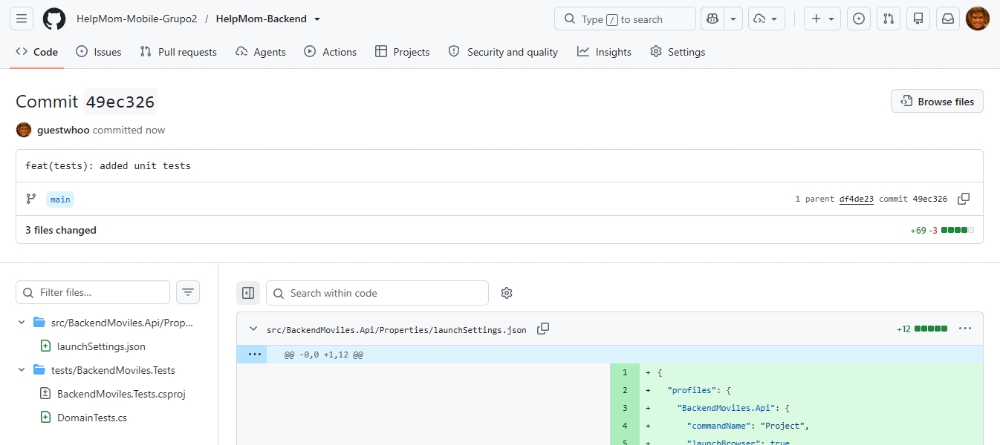
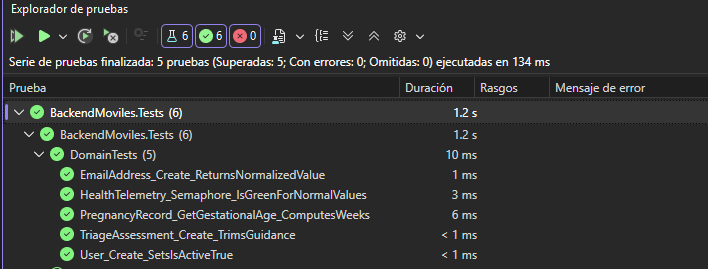
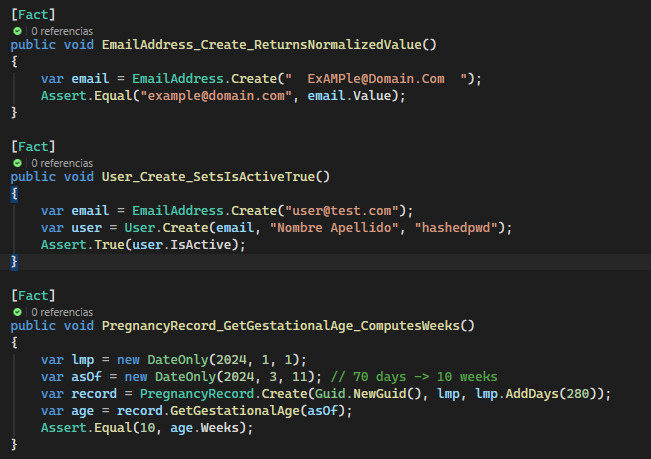
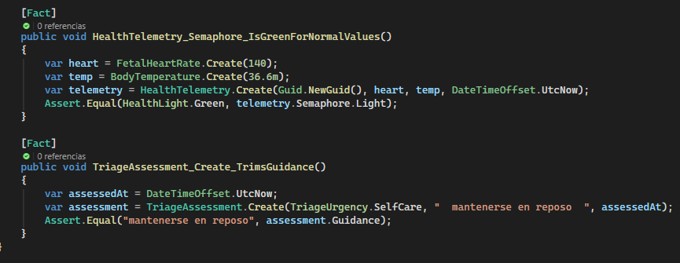
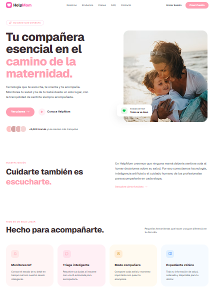
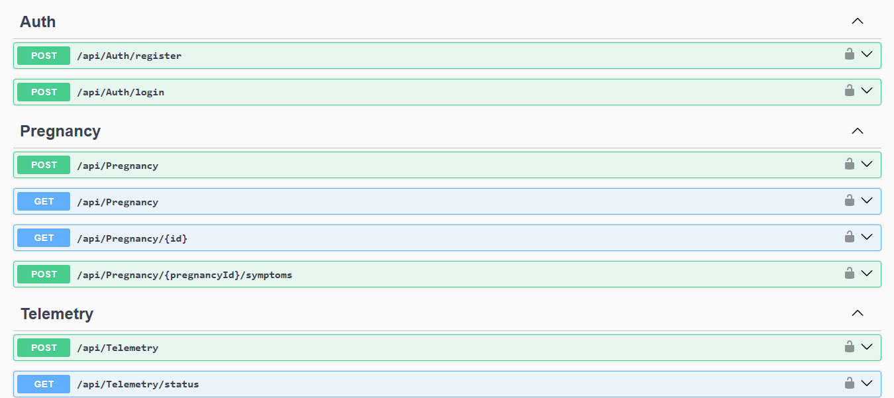
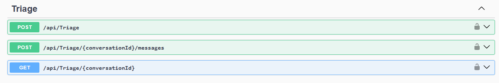
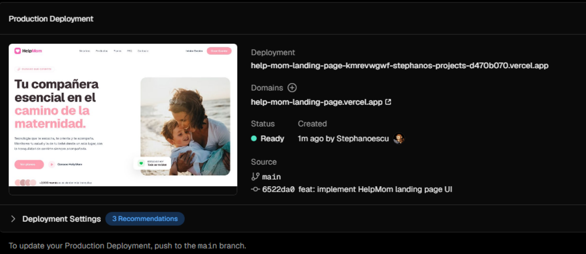
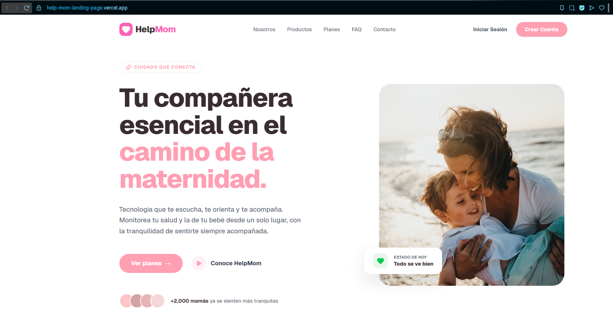

# Capítulo IV: Product Implementation & Validation

## 4.1. Software Configuration Management

La gestión de la configuración establece los estándares técnicos, herramientas y procedimientos automatizados que el equipo de desarrollo utiliza para garantizar la escalabilidad, el orden colaborativo y la calidad del código fuente a lo largo del ciclo de vida de HelpMom.


### 4.1.1. Software Development Environment Configuration

Se estandarizó un entorno de desarrollo ágil y moderno que permite al equipo trabajar de manera fluida en todas las capas del sistema (Frontend web, aplicación móvil y Backend de microservicios).

* **Entorno de Desarrollo Integrado (IDE):** Visual Studio Code, estandarizado para todo el equipo con extensiones clave (Prettier, ESLint, GitLens y asistentes de IA CopilotKit) para unificar la sintaxis y agilizar la escritura.
* **Desarrollo Web (Landing Page):** Entorno de ejecución Node.js con el framework React/Next.js y Tailwind CSS para la construcción e hidratación eficiente de componentes visuales con temas minimalistas.
* **Desarrollo Móvil:** Flutter SDK para la compilación multiplataforma (iOS y Android) de la aplicación principal.
* **Desarrollo Backend & IoT:** Entornos configurados con .NET, C# y Python para el procesamiento del triage de inteligencia artificial, la gestión de bases de datos relacionales y la recepción de telemetría desde los dispositivos IoT.

### 4.1.2. Source Code Management

El control de versiones del proyecto se gestiona íntegramente mediante Git, alojando los repositorios centrales en GitHub. Se ha adoptado un modelo de trabajo colaborativo basado en GitHub Flow para asegurar una integración continua robusta.

**Estructura de Ramas:**
* **`main`**: Rama de producción. Contiene el código estable, validado y desplegado. Está protegida contra commits directos.
* **`develop`**: Rama principal de integración donde se unifican todas las nuevas funcionalidades del Sprint antes de pasar a producción.
* **`feature/nombre-de-tarea`**: Ramas efímeras creadas a partir de develop para el desarrollo de nuevas historias de usuario (ej. `feature/landing-page-ui`, `feature/iot-bluetooth-sync`).

**Pull Requests (PR):** 
Toda integración de código requiere la apertura de un Pull Request hacia la rama `develop`, exigiendo la revisión de código (Code Review) por parte de otro miembro del equipo antes del merge.

### 4.1.3. Source Code Style Guide & Conventions

Para mantener la coherencia semántica y facilitar la lectura y mantenibilidad del código entre los distintos desarrolladores, se aplican normativas estrictas:

**Convenciones de Nomenclatura:**
* **`PascalCase`** para el nombramiento de Clases, Interfaces, Modelos de Dominio y Componentes UI (ej. `MedicalCheckUp`, `HealthCard`).
* **`camelCase`** para variables, funciones, métodos y propiedades (ej. `calculateGestationalWeek`, `vitalSigns`).
* **`kebab-case`** para nombres de archivos, directorios y rutas URL (ej. `patient-profile.tsx`, `auth-controller.cs`).

**Convenciones de Commits (Conventional Commits):** 
Los mensajes de commit se redactan en inglés, utilizando un verbo en imperativo y un prefijo estandarizado:
* **`feat:`** para nuevas funcionalidades.
* **`fix:`** para solución de errores (bugs).
* **`docs:`** para actualizaciones en la documentación técnica.
* **`refactor:`** para reestructuración de código sin alterar su comportamiento externo.

**Formateo Automático:** 
Uso de Prettier configurado en el guardado automático (format on save) para garantizar una indentación uniforme (2 espacios) y la estandarización de comillas y puntos y comas.

### 4.1.4. Software Deployment Configuration

El proceso de integración y despliegue continuo (CI/CD) está automatizado para minimizar la intervención manual y asegurar que las actualizaciones lleguen rápidamente a los usuarios.

* **Despliegue Frontend (Web):** La Landing Page y las aplicaciones web están conectadas directamente a Vercel. La plataforma detecta automáticamente los cambios en el repositorio de GitHub, ejecutando el proceso de build de Next.js y generando URLs de vista previa (Preview Deployments) por cada Pull Request. Las fusiones a la rama `main` disparan automáticamente un despliegue en el dominio de producción.
* **Despliegue Backend:** Los servicios en C#/.NET y Node.js se despliegan en instancias de la nube mediante canalizaciones automatizadas, garantizando que los Bounded Contexts operen de forma aislada y segura, respondiendo únicamente a las peticiones autorizadas (vía JWT) de las aplicaciones cliente.

### 4.2.1.4. Development Evidence for Sprint Review

En esta sección se demuestran los commits relacionados con los principales avances en la implementación.
Estos commits provienen del repositorio del Landing Page y Backend de la organización de GitHub.

Enlace al repositorio de la Landing Page: https://github.com/HelpMom-Mobile-Grupo2/HelpMom-LandingPage

Enlace al repositorio del Backend: https://github.com/HelpMom-Mobile-Grupo2/HelpMom-Backend

| Repository                                 | Branch | Commit Id                                 | Commit Message                                  | Commit Message Body | Commited on (Date) |
|------------------------------.|--------|-------------------------------------------|-------------------------------------------------|---------------------|--------------------|
| HelpMom-Mobile-Grupo2/HelpMom-LandingPage  | main   | d822c4402e13fc950c43f25a2915f0f30c59cde3  | feat: added pricing plans.                      |                     | 20/09/2026         |
| HelpMom-Mobile-Grupo2/HelpMom-LandingPage  | main   | 2db6b4c16b4cf4efe120070ad03a8cb6a181377c  | feat: added products, logo, fonts, banner image |                     | 20/09/2026         |
| HelpMom-Mobile-Grupo2/HelpMom-LandingPage  | main   | 50756f6abfdd6d3649061387d2c5281548dda5fe  | feat: add contact.                              |                     | 20/09/2026         |
| HelpMom-Mobile-Grupo2/HelpMom-LandingPage  | main   | e44f89b6f219466c6b48796457b9a890b4b7a777  | feat: added about us section with images        |                     | 20/09/2026         |
| HelpMom-Mobile-Grupo2/HelpMom-LandingPage  | main   | a2d38d2dacd1732a2e1a48d8b888e2f2a1cf9eaf  | feat: add FAQ.                                  |                     | 20/09/2026         |

### 4.2.1.5. Testing Suite Evidence for Sprint Review

Durante el Sprint 1 se implementaron pruebas unitarias e integrales para validar el correcto funcionamiento de los componentes desarrollados. Se logro validar lo siguiente:

* EmailAddress_Create_ReturnsNormalizedValue: verifica que la creación normaliza y guarda el email en minúsculas y sin espacios.
* User_Create_SetsIsActiveTrue: comprueba que al crear un usuario su propiedad IsActive queda a true.
* PregnancyRecord_GetGestationalAge_ComputesWeeks: valida que se calcula correctamente la edad gestacional (semanas) desde la fecha LMP.
* HealthTelemetry_Semaphore_IsGreenForNormalValues: asegura que para valores normales de frecuencia y temperatura el semáforo de salud es Green.
* TriageAssessment_Create_TrimsGuidance: confirma que la guía (guidance) se recorta (trim) al crear la evaluación de triaje.

Testing Commits

| Repository          | Branch | Commit ID | Commit Message               | Description                                                                                    | Committed On |
| ------------------- | ------ | --------- | ---------------------------- | ---------------------------------------------------------------------------------------------- | ------------ |
| helpmom-mobile-backend      | test   | 482e481   | feat: added unit tests | Implementación de pruebas unitarias e integrales para los componentes principales.| 2026-10-5   |

Figure 5.3.1.4.1 - GitHub commit associated with unit and integration tests.



Figure 5.3.1.4.2 - Test execution results.



Figura 5.3.1.4.3 - Tests content





### 4.2.1.6. Execution Evidence for Sprint Review

Durante el desarrollo del sprint se lograron completar todos los puntos planteados. A continuación se muestran evidencias del landing page logrado.



### 4.2.1.7. Services Documentation Evidence for Sprint Review

Se presenta la documentación técnica de la API del sistema. La imagen muestra una lista clara de todos los servicios disponibles y sus funciones, facilitando su uso y integración.





### 4.2.1.8. Software Deployment Evidence for Sprint Review

Como parte del cierre del Sprint, se evidencia que los incrementos de software desarrollados (Landing Page interactiva) han sido desplegados exitosamente y se encuentran operativos en un entorno público. El pipeline de integración continua de Vercel completó el proceso de compilación sin errores, asignando certificados SSL para navegación segura (HTTPS).





**Link Landing-Page:** [https://help-mom-landing-page.vercel.app/](https://help-mom-landing-page.vercel.app/)


#### 4.2.1.9. Team Collaboration Insights during Sprint

Durante el Sprint 1, el equipo consolidó el flujo colaborativo de GitHub entre el repositorio de diseño/informe y los repositorios de código (`HelpMom-LandingPage` y `HelpMom-Backend`). El principal reto fue coordinar la coherencia entre la estética maternal de la Landing Page y el modelo de dominio definido en el Capítulo II; se resolvió mediante revisiones rápidas por Pull Request y la validación unitaria temprana de las reglas críticas del negocio (semáforo y cálculo gestacional) antes de conectar los endpoints completos.

---

### 4.2.2. Sprint 2

#### 4.2.2.1. Sprint Planning 2

El **Sprint 2** tuvo como objetivo completar toda la lógica de negocio, contratos REST, políticas de seguridad y persistencia productiva en **HelpMom-Backend (.NET 8)** para habilitar los flujos completos de las dos aplicaciones móviles (Madre Gestante y Acompañante):

1. Implementar el módulo completo de **Vinculación Familiar (`Family`)** con generación de códigos temporales `HM-XXXX` (24h), unión por QR/clave y revocación de vínculo.
2. Implementar los endpoints del **Modo Compañero (`Companion`)**, garantizando estrictamente el ocultamiento de valores clínicos crudos (`Summary_DoesNotExposeClinicalValues`) y proveyendo los 3 tips diarios por semana gestacional.
3. Implementar el sistema de **Alertas Rápidas "Pasa la Voz" (`Alerts`)** y la política de **SOS automática** ante lecturas rojas o emergencias de triaje, con prevención de duplicados en ventanas de 10 minutos.
4. Añadir persistencia dual **SQLite (local)** y **PostgreSQL (Render)** con migraciones independientes, `Dockerfile` *multi-stage*, endpoint `/health` y una suite integral de pruebas de autorización, dominio y flujo extremo a extremo.

#### 4.2.2.2. Aspect Leaders and Collaborators

| Integrante | Rol / Liderazgo en Sprint 2 | Responsabilidades Clave |
| :--- | :--- | :--- |
| **Stephano Jose Espinoza Cueva** | Líder Backend & Cloud Docker/Render | Implementación de `feature/backend-companion-complete`, `feature/render-deploy`, persistencia PostgreSQL, `/health`, `Dockerfile` y contrato REST (`00_contrato_api_backend.md`). |
| **Gabriel Alejandro Rivera Ayala** | Líder Testing & Servicios REST | Documentación de endpoints por módulo en Swagger, verificación de pruebas de flujo (`prueba_manual.http`) y consolidación de evidencias técnicas. |
| **Jose Adrian Paredes Davila** | Líder Trazabilidad Móvil | Verificación de alineación entre el contrato JSON del Backend (`DTOs` y códigos enum) y las pantallas `PANT-01`–`PANT-05` del Capítulo III. |
| **Angelo Stephano Moscoso Bejar** | Gestión Ágil & Backlog Sprint 2 | Trazabilidad de historias del Backlog (`2.4.3`) ejecutadas en Sprint 2 y coordinación de pruebas funcionales cruzadas. |
| **Keyner Ivan Hancco Poma** | Líder Validación & Heurísticas | Preparación del protocolo de entrevistas de validación (`4.3.1`) y ejecución de la evaluación heurística sobre la Landing Page desplegada (`4.3.3`). |

#### 4.2.2.3. Sprint Backlog 2

| ID | Historia de Usuario / Técnica | Épica | Prioridad | Responsable | Estado |
| :--- | :--- | :---: | :---: | :--- | :--- |
| **TS02** | Validar token JWT y autorización estricta por rol (`Mother` / `Partner`) | EP02 | Alta | Stephano | Completado (Backend + Tests) |
| **TS04 / US11–US13** | Generar código QR (`HM-XXXX`), vincular acompañante y revocar vínculo | EP03 | Alta | Stephano | Completado (Backend + Tests) |
| **US29–US30 / TS10** | Registrar y actualizar embarazo (FUM/FPP), listar y registrar síntomas | EP08 | Alta | Stephano / Gabriel | Completado (Backend + Tests) |
| **US20** | Consultar historial de mediciones del sistema de semáforo | EP05 | Media | Stephano | Completado (Backend + Tests) |
| **US23 / US25 / TS09** | Listar conversaciones de triaje y detectar expresiones coloquiales de alarma | EP06 / EP07 | Alta | Stephano | Completado (Backend + Tests) |
| **TS07 / US34 / US45** | Exponer resumen seguro del acompañante sin datos clínicos crudos | EP05 / EP11 | Alta | Stephano | Completado (Backend + Tests) |
| **US42 / US44** | Proveer 3 tips diarios contextualizados a la semana gestacional y marcarlos hechos | EP11 | Alta | Stephano | Completado (Backend + Tests) |
| **TS13 / US47 / US48** | Enviar alertas rápidas "Pasa la Voz" y responder confirmación desde pareja | EP12 | Alta | Stephano | Completado (Backend + Tests) |
| **US27** | Disparar alerta SOS automática al acompañante ante telemetría roja o triaje crítico | EP07 | Alta | Stephano | Completado (Backend + Tests) |

#### 4.2.2.4. Development Evidence for Sprint Review

Los siguientes commits reales registrados en la rama `main` de **[HelpMom-Backend](https://github.com/HelpMom-Mobile-Grupo2/HelpMom-Backend)** evidencian el desarrollo completo de los módulos core y la preparación de despliegue en la nube durante el Sprint 2:

| Repository | Branch | Commit ID | Commit Message | Author | Committed on |
| :--- | :---: | :--- | :--- | :--- | :---: |
| HelpMom-Backend | main | `b081911` | `feat(companion): add quick alert, daily tip and tip completion domain model` | Stephano | 04/11/2026 |
| HelpMom-Backend | main | `d6e6bf1` | `feat(companion): add summary, quick alerts and daily tips use cases` | Stephano | 04/11/2026 |
| HelpMom-Backend | main | `666a737` | `feat(alerts): expose quick alert endpoints` | Stephano | 04/11/2026 |
| HelpMom-Backend | main | `4949983` | `feat(companion): expose summary and daily tips endpoints` | Stephano | 04/11/2026 |
| HelpMom-Backend | main | `28369b5` | `feat(alerts): raise automatic SOS on red telemetry without duplicates within 10 minutes` | Stephano | 04/11/2026 |
| HelpMom-Backend | main | `57e3564` | `feat(triage): list conversations, add colloquial emergency terms and raise SOS` | Stephano | 04/11/2026 |
| HelpMom-Backend | main | `8b1fc60` | `feat(telemetry): expose measurement history endpoint` | Stephano | 04/11/2026 |
| HelpMom-Backend | main | `e12b189` | `feat(pregnancy): expose update and delete endpoints for the owner` | Stephano | 04/11/2026 |
| HelpMom-Backend | main | `d349c89` | `feat(api): document endpoints with Swagger tags and typed responses` | Stephano | 04/11/2026 |
| HelpMom-Backend | main | `0a73312` | `feat(persistence): add PostgreSQL provider with DATABASE_URL support and its own migration` | Stephano | 04/11/2026 |
| HelpMom-Backend | main | `8805820` | `feat(api): add anonymous /health endpoint with database check` | Stephano | 04/11/2026 |
| HelpMom-Backend | main | `1aee76f` | `build: add multi-stage Dockerfile listening on PORT with 8080 fallback` | Stephano | 04/11/2026 |
| HelpMom-Backend | main | `f918a23` | `Merge pull request #1 from HelpMom-Mobile-Grupo2/feature/backend-companion-complete` | Phano_ec | 04/11/2026 |
| HelpMom-Backend | main | `6fa69e8` | `Merge pull request #2 from HelpMom-Mobile-Grupo2/feature/render-deploy` | Phano_ec | 04/11/2026 |

#### 4.2.2.5. Testing Suite Evidence for Sprint Review

En el Sprint 2 se amplió sustancialmente la suite `BackendMoviles.Tests` (proyecto `.NET 8` con `xUnit` y `Microsoft.AspNetCore.Mvc.Testing`) implementada en `HelpMom-Backend`, incorporando pruebas unitarias, de integración por roles, de privacidad, de política SOS y de humo sobre base relacional (`SQLite` y `PostgreSQL`):

| Archivo de Pruebas (`tests/BackendMoviles.Tests`) | Casos Implementados | Cobertura y Reglas Validadas |
| :--- | :---: | :--- |
| `DomainTests.cs` | 5 | Normalización de email, activación de usuario, cálculo de edad gestacional, clasificación semáforo verde y recorte de guía de triaje. |
| `FamilyTests.cs` | 13 | Registro por rol (`Mother`/`Partner`), bloqueo de rol inválido (`400`), emisión de `HM-XXXX`, unión por código, rechazo de códigos vencidos/usados/desconocidos (`409`/`404`) y revocación de vínculo. |
| `MotherEndpointsTests.cs` | 6 | Historial de telemetría ordenado con límite `count`, edición/eliminación de embarazo validando propiedad de la madre (`404` ante otra usuaria) y listado cronológico de conversaciones de triaje. |
| `CompanionTests.cs` | 13 | Privacidad clínica estricta (`Summary_DoesNotExposeClinicalValues`), estado sin mediciones, bloqueo si el partner no está vinculado (`409`), flujo completo de alertas "Pasa la Voz" (`Create`, `List`, `Respond`) y completado idempotente de tips diarios. |
| `EmergencyPolicyTests.cs` | 10 | Generación automática de alerta SOS para el acompañante ante telemetría roja o triaje de emergencia (`Emergency`), deduplicación de SOS en ventana de 10 minutos, reactivación tras respuesta y tolerancia a fallos (`EmergencyPolicyFailureTests`). |
| `ApiAuthorizationTests.cs` | 3 | Matriz de autorización JWT: rechazo `403 Forbidden` al invocar rutas de `Mother` con token `Partner` (y viceversa), `401 Unauthorized` sin token y agrupación de etiquetas Swagger. |
| `DeploymentTests.cs` | 7 | Conversión de `DATABASE_URL` hacia Npgsql, preservación de `sslmode`, selección del proveedor `PostgreSQL` y verificación del endpoint anónimo `/health`. |
| `EndToEndApplicationTests.cs` + `SqliteSmokeTests.cs` + `PostgreSqlSmokeTests.cs` | 3 suites | Flujo relacional completo entre los Bounded Contexts sobre migraciones reales de SQLite y PostgreSQL (`RelationalSmokeFlow`). |

#### 4.2.2.6. Execution Evidence for Sprint Review

Las funcionalidades core del ecosistema **HelpMom** operan actualmente sobre dos capas verificables: la **Landing Page productiva** desplegada en Vercel y la **API REST de `HelpMom-Backend`** validada mediante pruebas automatizadas y el flujo manual completo (`docs/prueba_manual.http`). *(Nota de transparencia: las aplicaciones móviles de Gestante y Acompañante se encuentran en desarrollo local y aún no cuentan con despliegue en tiendas ni APK distribuido).*

A continuación se documenta el funcionamiento de las **5 funcionalidades core** mediante la evidencia de la Landing Page y las trazas reales de ejecución del contrato Backend:

1. **Funcionalidad Core 1 — Landing Page Informativa y Planes de Suscripción (Web en Producción):**
   * Operativa públicamente en [https://help-mom-landing-page.vercel.app/](https://help-mom-landing-page.vercel.app/), exponiendo la propuesta de valor (*Cuidado que conecta*), los cuatro pilares del producto (*Monitoreo IoT*, *Triage inteligente*, *Modo compañero*, *Expediente clínico*), los planes (*Plan Básico* a `$9.99 / mes` y *Plan Cuidado Integral* a `$19.99 / mes`), preguntas frecuentes (FAQ) y formulario de contacto.
   * Evidencia visual de ejecución capturada en `assets/landing1.png` y `assets/evidencia_2.png`.

2. **Funcionalidad Core 2 — Registro Unificado por Rol y Vinculación Familiar mediante Código (`Auth & Family`):**
   * Al registrarse una gestante (`POST /api/auth/register`), se crea automáticamente su grupo familiar y recibe un token JWT válido por 60 minutos con rol `"Mother"`. Luego genera un código único de formato `HM-XXXX` (`POST /api/family/invitations`) vigente por 24 horas (invalidando invitaciones previas). El acompañante se registra con `"role": "Partner"` y se enlaza mediante `POST /api/family/join`, habilitando su `familyGroupId`:
   ```json
   // Respuesta real de POST /api/family/invitations (201 Created)
   { "code": "HM-9428", "expiresAt": "2026-11-05T16:30:00+00:00" }

   // Respuesta real de POST /api/family/join (200 OK)
   { "familyGroupId": "d9a1c3f0-...", "motherName": "Daniela Gómez" }
   ```

3. **Funcionalidad Core 3 — Seguimiento Gestacional y Monitoreo con Sistema de Semáforo (`Pregnancy & Telemetry`):**
   * La madre registra su FUM y FPP (`POST /api/pregnancy`), calculando dinámicamente `gestationalWeeks` y `gestationalDays`, además de registrar síntomas (`POST /api/pregnancy/{pregnancyId}/symptoms`).
   * Al ingresar una lectura simulada (`POST /api/telemetry`), el dominio evalúa los umbrales del semáforo (`Green = 1`, `Yellow = 2`, `Red = 3` para FCF `< 100` o `> 180`, o temperatura `>= 39.5 °C` o `< 35 °C`) y devuelve una interpretación textual tranquilizadora sin abrumar con gráficos complejos:
   ```json
   // Respuesta real de GET /api/telemetry/status (200 OK)
   {
     "id": "a18b2...",
     "motherUserId": "7f310...",
     "fetalHeartRateBpm": 140,
     "temperatureCelsius": 36.8,
     "measuredAt": "2026-11-03T01:00:00+00:00",
     "healthLight": 1,
     "healthSummary": "Valores dentro del rango de referencia simulado."
   }
   ```

4. **Funcionalidad Core 4 — Triage de Síntomas y Disparo Automático de Alerta SOS (`Triage & Emergency Policy`):**
   * Ante mensajes con términos de riesgo normalizados sin tildes (ej. *"sangrado abundante"*, *"rompí fuente"*, *"dolor intenso"*, *"no siento al bebé"*), `POST /api/triage` o `POST /api/triage/{conversationId}/messages` clasifica inmediatamente la conversación con `urgency = 3` (`Emergency`) y dispara una **alerta SOS automática (`type = 4`)** hacia el acompañante vinculado, evitando duplicados dentro de los siguientes 10 minutos (mismo comportamiento ante una medición roja en `/api/telemetry`):
   ```json
   // Respuesta de Triage en nivel Emergency (urgency = 3)
   {
     "id": "c41d...",
     "urgency": 3,
     "guidance": "Esta simulación detectó una posible señal de alarma. Comunícate de inmediato con tu obstetra o acude a emergencias."
   }
   ```

5. **Funcionalidad Core 5 — Modo Compañero con Privacidad Clínica, Tips del Día y Alertas "Pasa la Voz" (`Companion & Alerts`):**
   * Al consultar `GET /api/companion/summary`, el acompañante recibe exactamente 6 campos seguros (`motherName`, `gestationalWeeks`, `gestationalDays`, `healthLight`, `healthSummary`, `measuredAt`), **omitiendo estrictamente** frecuencia cardíaca exacta, temperatura y lista privada de síntomas (cualquier intento del acompañante de llamar a `/api/telemetry/status` devuelve `403 Forbidden`).
   * Adicionalmente, recibe 3 tips diarios contextualizados a la semana gestacional (`GET /api/companion/tips/today`), los marca como realizados (`POST /api/companion/tips/{id}/done`) y responde a las alertas rápidas "Pasa la Voz" enviadas por la madre (`POST /api/alerts/{id}/respond` con `1 = OnMyWay`, `2 = CallingNow`, `3 = Done`):
   ```json
   // Respuesta real de GET /api/companion/summary (200 OK - Sin valores clínicos crudos)
   {
     "motherName": "Daniela Gómez",
     "gestationalWeeks": 25,
     "gestationalDays": 1,
     "healthLight": 1,
     "healthSummary": "Valores dentro del rango de referencia simulado.",
     "measuredAt": "2026-11-03T01:00:00+00:00"
   }
   ```

> *Nota para la presentación:* Las vistas visuales correspondientes en móvil están diseñadas en el Capítulo III (`PANT-01`–`PANT-05`) y el flujo integral del backend se valida mediante [`docs/prueba_manual.http`](https://github.com/HelpMom-Mobile-Grupo2/HelpMom-Backend/blob/main/docs/prueba_manual.http). Cuando el equipo levante las apps en emulador local, se recomienda adjuntar aquí las capturas directas de Android Studio / Flutter conectadas a `http://10.0.2.2:61614/`.

#### 4.2.2.7. Services Documentation Evidence for Sprint Review

Durante el Sprint 2, el Backend REST (`HelpMom-Backend`) consolidó **26 endpoints** documentados en **Swagger/OpenAPI** (`/swagger`) con etiquetas por módulo y respuestas tipadas en formato `application/problem+json` para errores (`400`, `401`, `403`, `404`, `409`). El contrato oficial reside en [`docs/00_contrato_api_backend.md`](https://github.com/HelpMom-Mobile-Grupo2/HelpMom-Backend/blob/main/docs/00_contrato_api_backend.md):

| Módulo Swagger | Método y Ruta | Rol Autorizado | Descripción Funcional |
| :--- | :--- | :---: | :--- |
| **Auth** | `POST /api/auth/register` | Público | Registra usuario (`Mother` por defecto o `Partner`) y emite JWT (60 min). |
| **Auth** | `POST /api/auth/login` | Público | Autentica credenciales y devuelve token JWT junto con `familyGroupId` real y rol. |
| **Health** | `GET /health` | Público | Verifica disponibilidad de la API y conexión activa a SQLite / PostgreSQL (`200 Healthy`). |
| **Family** | `POST /api/family/invitations` | `Mother` | Genera código `HM-XXXX` válido por 24 h (anula invitaciones previas). |
| **Family** | `POST /api/family/join` | `Partner` | Vincula al acompañante con el grupo familiar usando el código de invitación. |
| **Family** | `DELETE /api/family/partner` | `Mother` | Revoca el vínculo del acompañante actual (`204 No Content`). |
| **Family** | `GET /api/family` | `Mother`, `Partner` | Devuelve el detalle del grupo familiar y sus miembros activos. |
| **Pregnancy** | `POST /api/pregnancy` / `GET /api/pregnancy` | `Mother` | Crea y lista registros de embarazo (FUM, FPP, cálculo de semanas y días). |
| **Pregnancy** | `GET` / `PUT` / `DELETE /api/pregnancy/{id}` | `Mother` | Consulta, actualiza o elimina el registro verificando propiedad de la usuaria. |
| **Pregnancy** | `POST /api/pregnancy/{pregnancyId}/symptoms` | `Mother` | Registra síntomas físicos con severidad (`1` Mild, `2` Moderate, `3` Severe). |
| **Telemetry** | `POST /api/telemetry` | `Mother` | Ingesta medición simulada (FCF y temperatura), clasifica en Semáforo y evalúa SOS. |
| **Telemetry** | `GET /api/telemetry/status` | `Mother` | Obtiene la última medición registrada y su resumen en lenguaje amigable. |
| **Telemetry** | `GET /api/telemetry/history?count=20` | `Mother` | Lista el historial de mediciones de la más reciente a la más antigua (`count` 1–500). |
| **Triage** | `POST /api/triage` / `GET /api/triage` | `Mother` | Inicia nueva conversación o lista conversaciones ordenadas cronológicamente. |
| **Triage** | `POST /api/triage/{conversationId}/messages` | `Mother` | Procesa mensaje de síntomas, detecta palabras clave de riesgo y dispara SOS si `urgency = 3`. |
| **Triage** | `GET /api/triage/{conversationId}` | `Mother` | Obtiene el historial completo de mensajes y nivel de urgencia de la conversación. |
| **Companion** | `GET /api/companion/summary` | `Partner` | Expone resumen seguro (semana, estado de semáforo) sin valores clínicos crudos. |
| **Companion** | `GET /api/companion/tips/today` | `Partner` | Retorna 3 consejos diarios contextualizados a la semana gestacional actual. |
| **Companion** | `POST /api/companion/tips/{id}/done` | `Partner` | Marca un tip diario como completado de manera idempotente (`204 No Content`). |
| **Alerts** | `POST /api/alerts` | `Mother` | Envía alerta rápida "Pasa la Voz" (`1` Craving, `2` TiredOrPain, `3` ComeHere, `4` Sos). |
| **Alerts** | `GET /api/alerts?status=pending\|all` | `Mother`, `Partner` | Consulta alertas del grupo familiar (`all` por defecto o solo `pending`). |
| **Alerts** | `POST /api/alerts/{id}/respond` | `Partner` | Registra respuesta del acompañante (`1` OnMyWay, `2` CallingNow, `3` Done). |

#### 4.2.2.8. Software Deployment Evidence for Sprint Review

Al cierre del Sprint 2, la infraestructura del ecosistema queda distribuida de la siguiente manera:

* **Landing Page (Producción):** Desplegada en **Vercel** con HTTPS activo en [https://help-mom-landing-page.vercel.app/](https://help-mom-landing-page.vercel.app/).
* **Backend REST (Docker / Render-ready):** Empaquetado mediante `Dockerfile` multi-stage (`mcr.microsoft.com/dotnet/sdk:8.0` → `aspnet:8.0`), ejecutando automáticamente migraciones de **PostgreSQL** (`DATABASE_URL` con `sslmode=require`) en la nube y verificando salud operativa vía `GET /health`. Documentado íntegramente en el [README de HelpMom-Backend](https://github.com/HelpMom-Mobile-Grupo2/HelpMom-Backend/blob/main/README.md).
* **Aplicaciones Móviles (Android & Flutter):** Configuradas en entorno local consumiendo el contrato unificado REST en JSON camelCase; pendientes de compilación final de paquete APK/AAB y distribución en tiendas/Firebase.

#### 4.2.2.9. Team Collaboration Insights during Sprint

En el Sprint 2, el equipo priorizó cerrar la brecha entre la arquitectura teórica del Capítulo II y una API REST real, verificable y lista para producción. La definición explícita de un contrato único (`00_contrato_api_backend.md`) y de un archivo reproducible de pruebas (`prueba_manual.http`) evitó desalineaciones entre el backend .NET y los clientes móviles Android/Flutter (especialmente en el manejo de fechas UTC con PostgreSQL y en la codificación numérica de los enums). Como mejora continua para el siguiente ciclo, queda pendiente empaquetar las versiones móviles conectadas a la instancia productiva en Render y realizar pruebas de campo grabadas con usuarios reales.

---

## 4.3. Validation Interviews

### 4.3.1. Diseño de Entrevistas

Para validar la comprensión de la propuesta de valor, la claridad del lenguaje de salud y la usabilidad de la **Landing Page desplegada** ([help-mom-landing-page.vercel.app](https://help-mom-landing-page.vercel.app/)) junto con los flujos diseñados de la app móvil, se estructuró una guía de entrevista semiestructurada de **12 preguntas** para cada segmento objetivo:

#### Segmento 1: Madres Gestantes (18 a 35 años)

1. **P1.** ¿Cuándo fue la última vez que buscaste en internet información sobre un síntoma o molestia durante tu embarazo? ¿Cómo te hizo sentir lo que encontraste?
2. **P2.** Al observar la sección inicial (*Hero*) de la Landing Page de HelpMom, ¿qué entiendes que hace la aplicación y cuál es su beneficio principal?
3. **P3.** ¿Te sientes identificada con el mensaje *"Tu compañera esencial en el camino de la maternidad"* y con el lema *"Cuidarte también es escucharte"*?
4. **P4.** En la sección *"Hecho para acompañarte"*, ¿qué te transmiten los cuatro pilares (*Monitoreo IoT*, *Triage inteligente*, *Modo compañero* y *Expediente clínico*)? ¿Alguno de esos nombres técnicos te resultó confuso?
5. **P5.** Si pudieras ver el estado de tu bebé mediante un semáforo simple (verde, amarillo o rojo) en lugar de cifras médicas complejas, ¿te generaría mayor tranquilidad o preferirías ver los números exactos?
6. **P6.** ¿Qué opinas de contar con un asistente conversacional que interrumpa el chat con una alerta roja y botón directo de llamada a emergencias cuando detecta síntomas graves?
7. **P7.** Respecto al botón de alerta rápida *"Pasa la Voz"* para avisarle a tu pareja que necesitas descanso o ayuda, ¿lo usarías en tu rutina diaria?
8. **P8.** Al revisar la sección *"Un plan para cada familia"* (*Plan Básico* a `$9.99 / mes` y *Plan Cuidado Integral* a `$19.99 / mes`), ¿entiendes claramente qué diferencia un plan del otro?
9. **P9.** ¿Consideras justo el precio de ambos planes frente al acompañamiento con IA e IoT que ofrecen? ¿Cuál elegirías?
10. **P10.** ¿Las preguntas frecuentes (*FAQ*) respondieron tus dudas sobre el sensor y si la app reemplaza la consulta médica? ¿Qué otra pregunta agregarías?
11. **P11.** ¿Hubo algún botón, enlace o sección de la página web que esperabas que funcionara distinto o que te generara desconfianza?
12. **P12.** Si la aplicación estuviera disponible hoy para descargar en tu celular, ¿la descargarías después de ver esta página? ¿Qué cambiarías para mejorarla?

#### Segmento 2: Padres y Acompañantes (18 a 40 años)

1. **P1.** Durante el embarazo de tu pareja, ¿en qué momentos sientes que no sabes cómo ayudar o qué está ocurriendo semana a semana?
2. **P2.** Al navegar por la Landing Page de HelpMom, ¿sientes que la plataforma también está pensada para ti como acompañante, o la percibes dirigida solo a la madre?
3. **P3.** ¿Te resultó fácil encontrar y comprender la funcionalidad del **Modo Compañero** dentro de la página?
4. **P4.** Si recibieras cada día 3 consejos breves y prácticos (*Tips para Papá*) adaptados a la semana actual del embarazo, ¿qué tan útil te parecería frente a buscar artículos largos?
5. **P5.** ¿Qué opinas de recibir en tu celular alertas rápidas (*"Pasa la Voz"*) como *"Siento cansancio, ¿puedes ayudarme?"* y poder responder con un toque (*"Voy en camino"*)?
6. **P6.** Para respetar la privacidad de la madre, tu vista muestra el resumen de bienestar sin exponer todos los síntomas clínicos privados. ¿Te parece adecuado ese límite de privacidad?
7. **P7.** En caso de que el sensor o el chat detecten una emergencia crítica, ¿te brinda tranquilidad recibir automáticamente una alerta SOS de respaldo?
8. **P8.** Al revisar los planes (`$9.99 / mes` vs `$19.99 / mes`), ¿qué tan claro queda que el *Modo Compañero* y el *Sensor IoT* forman parte del *Plan Cuidado Integral*?
9. **P9.** ¿Estarías dispuesto a contratar o regalar el *Plan Cuidado Integral* a tu pareja tras ver la propuesta de valor en la web?
10. **P10.** ¿La sección de FAQ y el formulario de contacto te brindan suficiente respaldo sobre el funcionamiento del sensor y los límites médicos de la plataforma?
11. **P11.** ¿Qué información adicional necesitarías ver en la Landing Page para animarte a registrarte hoy mismo?
12. **P12.** Si le recomendaras esta página a otro futuro papá, ¿qué destacarías como su mayor ventaja y qué corregirías con urgencia?

### 4.3.2. Registro de Entrevistas

*(Nota de estado del proyecto: Las entrevistas grabadas de validación post-implementación con usuarios externos de ambos segmentos quedan planificadas para ejecutarse una vez que se realice el despliegue en emulador/APK de las aplicaciones móviles. Para validar el producto actualmente desplegado, se ejecutó la evaluación experta mediante las **10 Heurísticas de Usabilidad de Jakob Nielsen** sobre la Landing Page en producción, documentada en la sección `4.3.3`).*

| ID | Segmento | Nombre del Entrevistado | Edad / Distrito | Enlace de Video y Timing | Hallazgos Clave (Resumen) |
| :-: | :--- | :--- | :---: | :--- | :--- |
| E1 | Segmento 1 (Madre) | *Pendiente de sesión post-despliegue móvil* | — | — | Guía validada en `4.3.1`; lista para registro de evidencia audiovisual. |
| E2 | Segmento 2 (Acompañante) | *Pendiente de sesión post-despliegue móvil* | — | — | Guía validada en `4.3.1`; lista para registro de evidencia audiovisual. |

### 4.3.3. Evaluaciones según heurísticas

#### UX Heuristics & Principles Evaluation — Usability, Inclusive Design & Information Architecture

El presente informe detalla la evaluación heurística de usabilidad aplicada a la **Landing Page oficial de HelpMom** (desplegada en [help-mom-landing-page.vercel.app](https://help-mom-landing-page.vercel.app/)) y a la arquitectura de información de los puntos de contacto con la solución móvil. La evaluación toma como marco metodológico los **10 Principios Heurísticos de Usabilidad de Jakob Nielsen**, complementados con criterios de diseño inclusivo (accesibilidad para madres gestantes) y claridad en la arquitectura de información para el acompañante.

---

#### 1. TAREAS A EVALUAR

##### 1.1 Tareas incluidas en esta evaluación

1. **Comprensión de la Propuesta de Valor (Hero Section):** Identificación del propósito de HelpMom, mensaje clave ("Cuidado que conecta", "Tu compañera esencial en el camino de la maternidad") y llamado a la acción inicial.
2. **Exploración de Funcionalidades Principales (Sección "Hecho para acompañarte"):** Navegación y entendimiento de los cuatro pilares del producto: *Monitoreo IoT*, *Triage Inteligente*, *Modo Compañero* y *Expediente Clínico*.
3. **Consulta y Comparación de Planes de Suscripción (Sección "Un plan para cada familia"):** Evaluación de la diferenciación entre el *Plan Básico* y el *Plan Cuidado Integral*, transparencia de precios y selección de compra.
4. **Resolución de Dudas Frecuentes (Sección FAQ):** Interacción con los acordeones de preguntas sobre el sensor IoT, valor diagnóstico y acompañamiento familiar.
5. **Intento de Contacto y Comunicación (Sección "Estamos a un mensaje de distancia"):** Interacción con el formulario de contacto directo, validación de campos y retroalimentación del envío.
6. **Navegación Global y Enlaces Legales (Header y Footer):** Uso de la barra de navegación fija, acceso a políticas de privacidad, términos de servicio y credenciales de confianza médica.

##### 1.2 Tareas NO incluidas en esta evaluación

1. **Transacción real mediante pasarela de pagos:** El flujo de checkout financiero completo aún no se encuentra conectado a una entidad bancaria productiva.
2. **Sincronización física por Bluetooth con el sensor IoT:** La ingesta de datos biométricos en hardware real se valida en fases de integración de laboratorio.

---

#### 2. ESCALA DE SEVERIDAD

Se utiliza la escala estandarizada de severidad de problemas de usabilidad de Jakob Nielsen:

| Nivel de Severidad | Denominación | Definición e Impacto |
| :---: | :--- | :--- |
| **0** | **Sin problema** | No representa una dificultad para el usuario; elemento o flujo bien resuelto. |
| **1** | **Cosmético** | Inconsistencia visual menor o detalle estético que no entorpece la tarea ni confunde al usuario. Reparar solo si hay tiempo disponible. |
| **2** | **Menor** | Causa fricción o demora leve. El usuario puede recuperarse por sí mismo. Debe asignársele baja prioridad en el backlog. |
| **3** | **Mayor** | Genera confusión notable, pérdida de confianza o dificulta seriamente la conversión del usuario. Alta prioridad de corrección. |
| **4** | **Catastrófico** | Bloquea totalmente la tarea, causa abandono inmediato del sitio o rompe la integridad del producto. Debe corregirse de inmediato. |

---

#### 3. TABLA DE RESUMEN DE PROBLEMAS ENCONTRADOS

| Código | Heurística de Jakob Nielsen | Problemas Detectados | Severidad Máxima |
| :---: | :--- | :---: | :---: |
| **H1** | Visibilidad del estado del sistema | 2 | **2 (Menor)** |
| **H2** | Coincidencia entre el sistema y el mundo real | 2 | **2 (Menor)** |
| **H3** | Control y libertad del usuario | 2 | **2 (Menor)** |
| **H4** | Consistencia y estándares | 3 | **3 (Mayor)** |
| **H5** | Prevención de errores | 2 | **2 (Menor)** |
| **H6** | Reconocimiento antes que recuerdo | 2 | **2 (Menor)** |
| **H7** | Flexibilidad y eficiencia de uso | 2 | **2 (Menor)** |
| **H8** | Diseño estético y minimalista | 1 | **1 (Cosmético)** |
| **H9** | Ayudar a los usuarios a reconocer, diagnosticar y recuperarse de errores | 2 | **2 (Menor)** |
| **H10** | Ayuda y documentación | 2 | **3 (Mayor)** |

---

#### 4. EVALUACIÓN DETALLADA POR HEURÍSTICA

---

##### H1 — Visibilidad del Estado del Sistema

> *El sistema debe mantener siempre informados a los usuarios de lo que está ocurriendo, mediante una retroalimentación adecuada y dentro de un tiempo razonable.*

**Problemas detectados**

| Problema | Evidencia en la Landing Page | Severidad |
| :--- | :--- | :---: |
| Los botones de autenticación en la barra de navegación (**Iniciar Sesión** y **Crear Cuenta**) no proporcionan ninguna indicación visual de estado, carga o interacción al hacer clic sobre ellos. | Al interactuar con ambos botones en el header, no se despliega ningún modal ni ocurre una redirección; permanecen estáticos sin respuesta. | **2** |
| El formulario de contacto en la sección *"Estamos a un mensaje de distancia"* no muestra un indicador de carga (spinner) ni un mensaje de confirmación de recepción ("¡Mensaje recibido con éxito!") tras presionar el botón *"Enviar mensaje"*. | El usuario presiona el botón pero la interfaz no cambia de estado, generando incertidumbre sobre si el mensaje fue enviado o si hubo un fallo de red. | **2** |

**Recomendaciones**

| # | Recomendación |
| :-: | :--- |
| 1 | Incluir un estado *disabled* temporal con spinner de carga al enviar el formulario de contacto, seguido de un banner o toast de confirmación verde visible. |
| 2 | Mientras la autenticación se encuentre en desarrollo, agregar un tooltip informativo o modal temporal ("Próximamente disponible en la app móvil") al hacer clic en los botones de login y registro. |

---

##### H2 — Coincidencia entre el Sistema y el Mundo Real

> *El sistema debe hablar el lenguaje de los usuarios, con palabras, frases y conceptos familiares para ellos, en lugar de términos orientados al sistema o jerga técnica.*

**Problemas detectados**

| Problema | Evidencia en la Landing Page | Severidad |
| :--- | :--- | :---: |
| Uso de terminología técnica en las tarjetas descriptivas como *"Triage inteligente"* y *"Monitoreo IoT"*, conceptos que pueden resultar fríos o intimidantes para una madre gestante primeriza. | En la sección *"Hecho para acompañarte"*, se presentan los títulos *"Monitoreo IoT"* y *"Triage inteligente"* sin una explicación inmediata en lenguaje coloquial de lo que representan para la salud diaria. | **2** |
| La descripción del producto hace alusión a un "asistente inteligente" sin aclarar explícitamente desde el primer párrafo si se trata de un chatbot conversacional o una guía estructurada. | Una madre gestante podría asumir que hablará directamente con un ginecólogo de guardia en lugar de un sistema automatizado de contención y orientación inicial. | **1** |

**Recomendaciones**

| # | Recomendación |
| :-: | :--- |
| 1 | Acompañar los títulos técnicos con subtítulos amigables; por ejemplo: *"Monitoreo IoT (Lectura de signos con tu pulsera inteligente)"* y *"Triage Inteligente (Evaluación rápida de síntomas 24/7)"*. |
| 2 | Resaltar en el Hero que el servicio combina soporte virtual continuo con protocolos médicos seguros de derivación oportuna. |

---

##### H3 — Control y Libertad del Usuario

> *Los usuarios a menudo eligen funciones del sistema por error y necesitan una "salida de emergencia" claramente señalada para abandonar el estado no deseado sin tener que pasar por un diálogo extendido.*

**Problemas detectados**

| Problema | Evidencia en la Landing Page | Severidad |
| :--- | :--- | :---: |
| Al presionar el botón *"Ver planes →"* en el Hero, la vista se desplaza hacia abajo de forma prolongada, pero no existe un botón flotante de retorno rápido al inicio (*Back-to-top*). | En dispositivos móviles, la usuaria debe realizar un scroll inverso continuo a lo largo de varias secciones para regresar a la cabecera del sitio. | **2** |
| El formulario de contacto no cuenta con una acción de limpieza o restablecimiento de campos en caso de que el usuario desee reiniciar la redacción de su consulta. | La usuaria debe borrar manualmente carácter por carácter si decide cancelar la redacción de un mensaje extenso. | **1** |

**Recomendaciones**

| # | Recomendación |
| :-: | :--- |
| 1 | Implementar un botón flotante discreto en la esquina inferior derecha con icono de flecha hacia arriba (*Scroll to top*) que aparezca tras rebasar la primera pantalla. |
| 2 | Permitir que al recargar la sección o presionar una opción secundaria se restablezcan los campos del formulario con suavidad. |

---

##### H4 — Consistencia y Estándares

> *Los usuarios no deberían tener que preguntarse si diferentes palabras, situaciones o acciones significan lo mismo. Siga las convenciones de la plataforma.*

**Problemas detectados**

| Problema | Evidencia en la Landing Page | Severidad |
| :--- | :--- | :---: |
| La pestaña del navegador y los metadatos SEO conservan los valores por defecto del template de Next.js (`<title>Create Next App</title>` y `<meta name="description" content="Generated by create next app"/>`). | Al abrir la Landing Page en cualquier navegador o compartir el enlace por WhatsApp/redes, el título visible es *"Create Next App"*, afectando gravemente la imagen institucional y credibilidad médica. | **3** |
| Inconsistencia en la microcopia y estilos de los botones de llamada a la acción (CTA) a lo largo de la página (*"Ver planes →"*, *"Conoce HelpMom"*, *"Comenzar ahora"*, *"Descubre cómo funciona →"*). | Los botones principales presentan variaciones de relleno, bordes redondeados y flechas tipográficas sin una jerarquía visual homogénea entre primarios y secundarios. | **2** |
| El favicón mostrado en el navegador corresponde al icono predeterminado de Vercel/Next.js y no al isotipo oficial del corazón de HelpMom. | En la barra de pestañas se visualiza el triángulo negro de Vercel en lugar del logo rosado de HelpMom. | **2** |

**Recomendaciones**

| # | Recomendación |
| :-: | :--- |
| 1 | **(Prioridad Alta)** Actualizar el archivo `layout.tsx` de Next.js configurando el título oficial: `"HelpMom — Cuidado que conecta | Tu compañera esencial en la maternidad"` y el meta tag descriptivo correspondiente. |
| 2 | Reemplazar el `favicon.ico` del proyecto con el isotipo oficial del corazón de HelpMom. |
| 3 | Estandarizar la guía de botones: Botón Primario (fondo rosa `#FF9FB2`, texto blanco, esquinas redondeadas) y Botón Secundario (borde rosa, fondo transparente). |

---

##### H5 — Prevención de Errores

> *Mucho mejor que los buenos mensajes de error es un diseño cuidadoso que impida que ocurra un problema en primer lugar.*

**Problemas detectados**

| Problema | Evidencia en la Landing Page | Severidad |
| :--- | :--- | :---: |
| El campo de correo electrónico del formulario de contacto carece de validación preventiva en tiempo real (regex para formato `@` y dominio `.com`/`.pe`). | Permite ingresar cadenas sin formato de correo electrónico y habilitar el botón de envío sin alertar antes del clic. | **2** |
| En la sección de precios, los botones *"Comenzar ahora"* de ambos planes no detallan si el cobro es automático o si existe un periodo de prueba gratuito previo. | Puede generar temor al usuario de incurrir en un cargo no autorizado de forma inmediata sin conocer el proceso de facturación. | **2** |

**Recomendaciones**

| # | Recomendación |
| :-: | :--- |
| 1 | Incorporar validación sintáctica de correo con atributos HTML5 (`type="email"` y `required`) y deshabilitar el botón de envío hasta que los campos obligatorios cumplan con el patrón válido. |
| 2 | Agregar una microetiqueta explicativa bajo los precios: *"Cancela en cualquier momento. 7 días de prueba sin costo"*. |

---

##### H6 — Reconocimiento antes que Recuerdo

> *Haga visibles los objetos, las acciones y las opciones. El usuario no debería tener que recordar información de una parte de la interfaz a otra.*

**Problemas detectados**

| Problema | Evidencia en la Landing Page | Severidad |
| :--- | :--- | :---: |
| Los dos planes de precios (*Plan Básico* a `$9.99 / mes` y *Plan Cuidado Integral* a `$19.99 / mes`) se presentan en tarjetas independientes sin una tabla comparativa directa de características (*checkmarks* lado a lado). | La usuaria debe memorizar mentalmente los beneficios del plan básico para compararlos con las inclusiones adicionales del plan integral. | **2** |
| La barra de navegación superior no resalta visualmente la sección activa (*scrollspy*) a medida que el usuario se desplaza por la página. | El usuario pierde noción de en qué sección temática del documento se encuentra ubicado durante la navegación prolongada. | **1** |

**Recomendaciones**

| # | Recomendación |
| :-: | :--- |
| 1 | Integrar una fila comparativa o lista con viñetas destacadas donde se aprecie claramente qué funciones exclusivas añade el Plan Integral (ej. *Monitoreo IoT avanzado* y *Triage 24/7 sin límite*). |
| 2 | Implementar un indicador activo (color rosa o subrayado suave) en los ítems de la barra de navegación (*Nosotros*, *Productos*, *Planes*, *FAQ*, *Contacto*) sincronizado con el scroll. |

---

##### H7 — Flexibilidad y Eficiencia de Uso

> *Los aceleradores —invisibles para el usuario novato— a menudo pueden acelerar la interacción para el usuario experto de tal manera que el sistema pueda atender tanto a usuarios inexpertos como experimentados.*

**Problemas detectados**

| Problema | Evidencia en la Landing Page | Severidad |
| :--- | :--- | :---: |
| Ausencia de insignias oficiales (*badges*) para acceso rápido a la descarga de la app móvil en Google Play Store o Apple App Store en la sección Hero. | Las usuarias que visitan la web desde su celular con la intención directa de instalar la app no disponen de un acceso directo en el primer pantallazo. | **2** |
| Las preguntas frecuentes (FAQ) carecen de un buscador rápido o categorización por temas (*Sensor IoT*, *Suscripción*, *Médico*), obligando a expandir los ítems uno a uno. | Un usuario con una consulta puntual sobre la compatibilidad de su teléfono debe revisar secuencialmente todas las preguntas. | **1** |

**Recomendaciones**

| # | Recomendación |
| :-: | :--- |
| 1 | Añadir botones representativos de *"Disponible próximamente en Google Play y App Store"* en el Hero para canalizar la expectativa de instalación. |
| 2 | Agrupar las preguntas frecuentes en pestañas temáticas breves para acelerar la localización de respuestas. |

---

##### H8 — Diseño Estético y Minimalista

> *Las interfaces no deben contener información que sea irrelevante o que rara vez se necesite. Cada unidad adicional de información en una interfaz compite con las unidades relevantes.*

**Problemas detectados**

| Problema | Evidencia en la Landing Page | Severidad |
| :--- | :--- | :---: |
| Determinados párrafos informativos en gris tenue (`text-gray-500`) sobre fondos claros no alcanzan el ratio de contraste mínimo recomendado (4.5:1) según las pautas de accesibilidad **WCAG 2.1 nivel AA**. | Madres gestantes que experimentan fatiga visual o navegan en ambientes con luz solar directa pueden tener dificultad para leer textos secundarios. | **1** |

**Recomendaciones**

| # | Recomendación |
| :-: | :--- |
| 1 | Ajustar el color de los textos secundarios de `#6B7280` (`text-gray-500`) a `#374151` (`text-gray-700`) para garantizar un contraste nítido y accesible sin perder la estética delicada de la marca. |

---

##### H9 — Ayudar a los Usuarios a Reconocer, Diagnosticar y Recuperarse de Errores

> *Los mensajes de error deben expresarse en lenguaje llano (sin códigos técnicos), indicar con precisión el problema y sugerir constructivamente una solución.*

**Problemas detectados**

| Problema | Evidencia en la Landing Page | Severidad |
| :--- | :--- | :---: |
| En caso de omitir campos requeridos en el formulario de contacto, no aparecen mensajes de error textuales en línea (*inline validation*) que indiquen qué campo falta llenar. | La interfaz únicamente confía en la validación por defecto del navegador, la cual puede ser inconsistente entre diferentes marcas de dispositivos móviles. | **2** |
| No existe indicación visible de qué hacer en caso de una falla en el servidor al intentar enviar el formulario. | Si el backend de soporte no responde, el usuario se queda sin una alternativa de contacto directo (ej. enlace a correo electrónico de soporte o número de WhatsApp). | **2** |

**Recomendaciones**

| # | Recomendación |
| :-: | :--- |
| 1 | Incorporar textos de validación en color rojo suave bajo cada campo: *"Por favor, ingresa tu nombre completo"* y *"Se requiere un correo electrónico válido"*. |
| 2 | Proveer un canal de contingencia visible: *"¿Tienes problemas con el formulario? Escríbenos directamente a soporte@helpmom.pe"*. |

---

##### H10 — Ayuda y Documentación

> *Incluso aunque el sistema pueda utilizarse sin documentación previa, suele ser necesario proporcionar ayuda y documentación clara, fácil de buscar y centrada en la tarea.*

**Problemas detectados**

| Problema | Evidencia en la Landing Page | Severidad |
| :--- | :--- | :---: |
| Los enlaces del pie de página correspondientes a **"Términos y condiciones"**, **"Política de privacidad"** y **"Ayuda"** no tienen destino funcional (apuntan a `#`). | Siendo una aplicación orientada a la salud materna y la recopilación de datos biométricos sensibles (temperatura, pulso, historial de gestación), la ausencia de una política de privacidad accesible genera desconfianza legal y ética. | **3** |
| No se aclara de forma explícita el descargo de responsabilidad médica (*Medical Disclaimer*) en la zona visible de planes o pie de página. | Es indispensable informar que HelpMom es una herramienta de acompañamiento y soporte de bienestar que en ningún caso sustituye el diagnóstico ni la atención médica de emergencia de un obstetra colegiado. | **3** |

**Recomendaciones**

| # | Recomendación |
| :-: | :--- |
| 1 | **(Prioridad Alta)** Crear páginas o modales funcionales para la *Política de Privacidad y Tratamiento de Datos Personales (Ley N° 29733 de Perú)* y los *Términos del Servicio*. |
| 2 | **(Prioridad Alta)** Incluir un *Medical Disclaimer* visible en el pie de página: *"HelpMom es un dispositivo y plataforma de monitoreo y bienestar maternal. No reemplaza el control prenatal médico periódico ni las consultas ginecológicas de urgencia"*. |

---

#### 5. CONSOLIDADO FINAL POR SEVERIDAD

| Nivel de Severidad | Cantidad de Problemas | Heurísticas Afectadas | Acciones Clave |
| :--- | :---: | :--- | :--- |
| **4 — Catastrófico** | 0 | Ninguna | No se registraron bloqueos críticos absolutos en la navegación base. |
| **3 — Mayor** | 3 | **H4, H10** | 1. Cambiar títulos y metadatos de Next.js (`<title>` y favicón).<br>2. Habilitar páginas de Política de Privacidad y Términos.<br>3. Insertar descargo de responsabilidad médica (*Medical Disclaimer*). |
| **2 — Menor** | 14 | **H1, H2, H3, H4, H5, H6, H7, H9** | 1. Incorporar feedback y loaders en formulario de contacto.<br>2. Añadir comparador visual directo entre planes.<br>3. Incluir botón flotante de retorno al inicio.<br>4. Suavizar terminología técnica hacia lenguaje cotidiano. |
| **1 — Cosmético** | 3 | **H2, H3, H8** | 1. Mejorar ratios de contraste de textos grises (WCAG AA).<br>2. Homogeneizar curvaturas y microcopias de botones secundarios. |
| **Total** | **20** | — | — |

---

#### 6. CONCLUSIONES

| Dimensión Analizada | Hallazgos Principales |
| :--- | :--- |
| **Fortalezas del Producto** | La Landing Page posee una estética visual sumamente cálida, empática y coherente con el público objetivo de maternidad. La sección *"Hecho para acompañarte"* comunica con mucha claridad los cuatro diferenciales del producto (IoT, Triage, Modo Compañero y Expediente). El sistema de FAQ anticipa dudas genuinas de las madres y sus parejas. |
| **Bloqueadores y Riesgos Críticos** | Los puntos de mayor urgencia correctiva residen en los metadatos residuales del template (`Create Next App`) y la falta de enlaces funcionales para las Políticas de Privacidad y el Descargo de Responsabilidad Médica (*Medical Disclaimer*), aspectos no negociables en productos de salud digital. |
| **Oportunidades de Optimización UX** | Facilitar la comparación visual directa entre los dos planes de suscripción, proveer retroalimentación interactiva a las acciones del usuario (formulario y botones de acceso) y brindar atajos evidentes para anticipar la disponibilidad de la aplicación móvil. |
| **Plan de Acción Priorizado** | 1. Corregir metadatos y favicón en el código fuente de Next.js.<br>2. Redactar el Disclaimer Médico y las Políticas de Privacidad en el footer.<br>3. Añadir tabla comparativa de beneficios en los planes.<br>4. Sincronizar estas mejoras antes de la presentación final del curso. |

